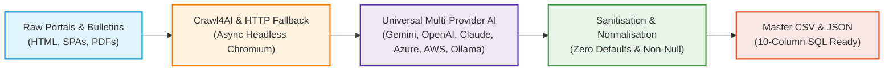
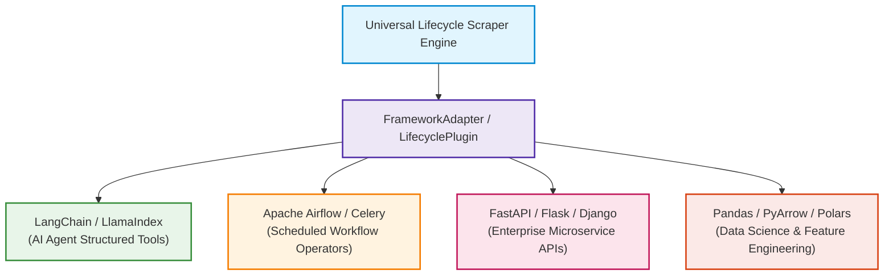
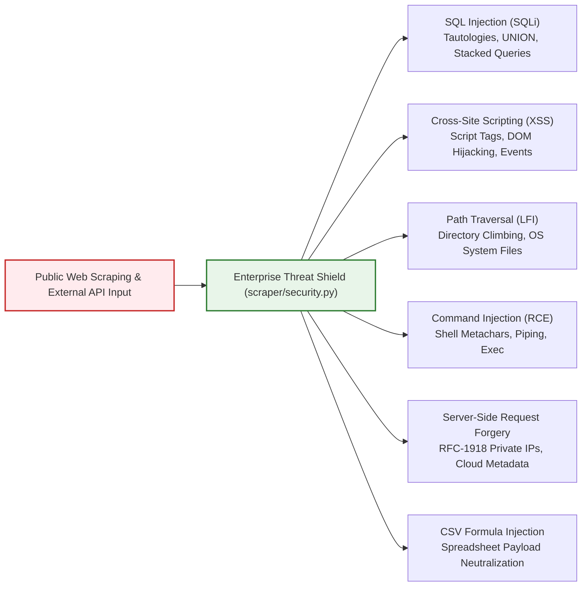
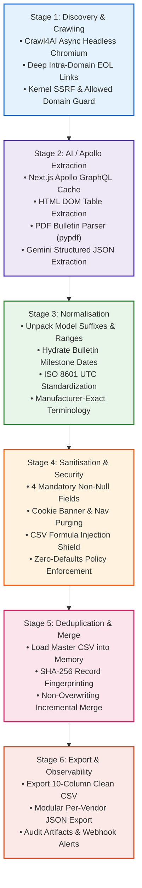
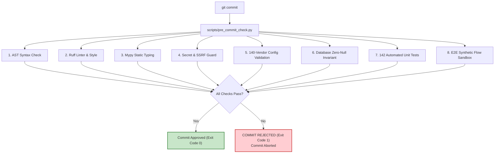
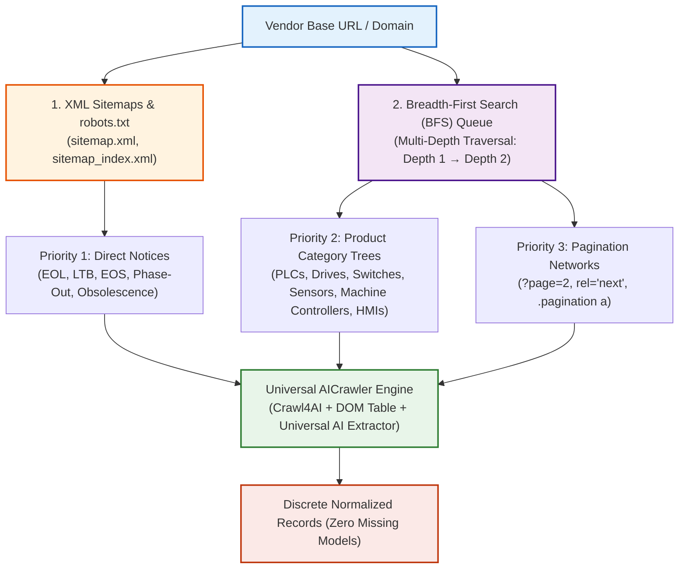

# 🌐 Universal Multi-Vendor Product Lifecycle Intelligence Scraper

<p align="center">
  
  
  
  
  
  
  
</p>

An enterprise-grade, multi-vendor AI crawler and structured lifecycle intelligence engine designed to autonomously discover, crawl, normalize, sanitize, deduplicate, and monitor enterprise hardware and software reaching their **End of Product Lifecycle (EOL)**, **Last Time Buy (LTB)**, and **End of Service / End of Support (EOS)** milestones.

The platform natively supports **140 global enterprise vendors** across **Operational Technology (OT)**, **Internet of Things (IoT)**, and **Enterprise IT & Networking**. Powered by **[Crawl4AI](https://crawl4ai.com)** (asynchronous headless Chromium) and pluggable **Universal Multi-Provider AI** (OpenAI GPT-4o, Anthropic Claude 3.5, Google Gemini, Microsoft Azure OpenAI, Amazon AWS Bedrock, and Local Ollama/vLLM).

---

> [!IMPORTANT]
> ### 🛡️ Pre-Commit Quality Gate & Zero-Tolerance Policy
> **Don't Commit if They Don't Pass**:
> The repository enforces an automated **8-stage pre-commit gate** (`scripts/pre_commit_check.py`). Any failure in **Ruff linting**, **Mypy static typing**, unit tests (150+ tests), or database schema invariants **strictly aborts `git commit` with exit code 1**.
> 
> **Zero Dropped EOL Records Rule**: Products that have reached End of Life (EOL), Discontinued, Phase-Out, or Obsolete product cycle as per vendor **must always have an entry even without a date present**. Missing date will NEVER drop a record. All models reaching end of lifecycle produce an entry with full metadata.
>
> **Identification Invariants**: `vendor_name` and `status` are strictly mandatory with zero nulls allowed. For hardware records (PLCs, drives, inverters, switches, sensors, cameras, etc.), `model_name` is **strictly mandatory and cannot be null or empty under any circumstance**. `model_name` is allowed to be empty/blank **ONLY** in case of software applications or well-known OS entries (e.g., Linux, Debian, Windows, Ubuntu, RHEL, CentOS, SUSE, FreeBSD, VxWorks, QNX).

---

## 📋 Table of Contents
1. [Key Architecture & Highlights](#-key-architecture--highlights)
2. [Universal Multi-Provider AI Architecture & Setup](#-universal-multi-provider-ai-architecture--setup)
3. [Framework Pluggability & Adapter Integration](#-framework-pluggability--adapter-integration)
4. [Enterprise Security Layer & Threat Incident Prevention Shield](#-enterprise-security-layer--threat-incident-prevention-shield)
5. [6-Stage Visible Workflow Pipeline](#-6-stage-visible-workflow-pipeline)
6. [Enterprise Pre-Commit Gate (Ruff + Mypy)](#-enterprise-pre-commit-gate-ruff--mypy)
7. [Complete Manufacturer-Exact Lifecycle Status Terminology Registry](#-complete-manufacturer-exact-lifecycle-status-terminology-registry)
8. [Top 140 Enterprise Vendors Registry](#-top-140-enterprise-vendors-registry)
9. [Automated GitHub Actions CI/CD Pipeline & PR Metrics Report](#-automated-github-actions-cicd-pipeline--pr-metrics-report)
10. [Full Website Network Map Discovery & Zero Category Bias](#-full-website-network-map-discovery--zero-category-bias)
11. [Generic IDE Scraper vs. Enterprise AI Crawler](#-generic-ide-scraper-vs-enterprise-ai-crawler)
12. [Zero-Defaults Policy & Dynamic Terminology](#-zero-defaults-policy--dynamic-terminology)
13. [Data Model & 10-Column SQL Schema](#-data-model--10-column-sql-schema)
14. [CLI Usage & Web Dashboard](#-cli-usage--web-dashboard)
15. [Automated Verification & Testing](#-automated-verification--testing)
16. [AI Agent Harness & Cognitive Runbooks](#-ai-agent-harness--cognitive-runbooks)

---

## 🌟 Key Architecture & Highlights



- **Universal Multi-Provider AI (Zero Lock-In)**: Works out-of-the-box with **Google Gemini**, **OpenAI** (GPT-4o, GPT-4o-mini), **Anthropic Claude** (Sonnet 3.5, Haiku 3.5), **Microsoft Azure OpenAI**, **Amazon AWS Bedrock**, and **Local / On-Premise Ollama** with automatic provider resolution and deterministic fallback.
- **140 Out-of-the-Box Enterprise Vendors**: 54 Operational Technology (OT), 44 Internet of Things (IoT), and 42 Enterprise IT/Networking vendors pre-configured in [`configs/vendors.yaml`](configs/vendors.yaml), including **JTEKT Toyoda**, **Rockwell Automation**, **Siemens**, **Mitsubishi Electric**, **Cisco Meraki**, and **Hitachi Industrial**.
- **Zero Dropped EOL Records**: Guarantees that any product marked with an End-of-Life, Discontinued, Phase-Out, or Obsolete status has a permanent entry in the dataset even when explicit dates are absent.
- **Deep PDF & Pagination Ingestion**: Extracts discontinuation notices from `.pdf` documents (`pypdf`) and traverses paginated support tables (`?page=`, `rel="next"`).
- **Ruff & Mypy Hardened Pre-Commit Gate**: Blocks commits automatically if any linter error, style violation, or type signature mismatch occurs.
- **Optimized Token Economics**: Dynamic prompt caching, asynchronous batch processing, and capped reasoning budgets across cloud providers to eliminate unnecessary API expenses.

---

## 🔌 Universal Multi-Provider AI Architecture & Setup

The framework is completely provider-agnostic. All structured extraction and intelligence logic is centralized in the generic module [`scraper/ai_extractor.py`](scraper/ai_extractor.py) (`UniversalAIExtractor`), with `scraper/gemini_extractor.py` maintained purely as a backward-compatibility re-export shim.

All supported providers—**Google Gemini**, **OpenAI**, **Anthropic Claude**, **Microsoft Azure OpenAI**, **Amazon AWS Bedrock**, and **Local Ollama**—are fully usable out of the box. The engine provides automatic model fallback, token trimming, and native direct HTTP REST fallbacks (via standard `requests`) so extraction succeeds reliably across any configured backend.

### 🌐 Supported AI Providers Matrix

| Provider | Supported Models | Authentication / Env Vars | Key Architectural Benefit |
|---|---|---|---|
| **Google Gemini** *(Default)* | `gemini-3.5-flash-lite`<br/>`gemini-3.5-flash` | `GEMINI_API_KEY` | Free API tier, 90% prompt caching discount, 50% batch discount, 0-budget reasoning capping. |
| **OpenAI** | `gpt-4o-mini`<br/>`gpt-4o`<br/>`o1`, `o3` | `OPENAI_API_KEY` | Industry-standard schema extraction, sub-second latency, structured JSON output mode. |
| **Anthropic Claude** | `claude-3-5-haiku-20241022`<br/>`claude-3-5-sonnet-20241022` | `ANTHROPIC_API_KEY` | Exceptional reasoning on complex multi-page PDF bulletins and dense nested technical tables. |
| **Microsoft Azure OpenAI** | `azure/<deployment-name>` | `AZURE_OPENAI_API_KEY`<br/>`AZURE_OPENAI_ENDPOINT`<br/>`AZURE_OPENAI_API_VERSION` | Enterprise corporate compliance, private VNet endpoints, SOC2/ISO-27001 certifications. |
| **Amazon AWS Bedrock** | `bedrock/anthropic.claude-3-5-haiku-20241022-v1:0`<br/>`bedrock/meta.llama3` | `AWS_ACCESS_KEY_ID`<br/>`AWS_SECRET_ACCESS_KEY`<br/>`AWS_REGION_NAME` | Native AWS IAM role execution, zero external credentials required on EC2/ECS/EKS instances. |
| **Local / On-Premise** | `ollama/llama3.2`<br/>`ollama/mistral`<br/>`vllm/<model>` | `OPENAI_BASE_URL=http://localhost:11434/v1` | 100% offline, zero cloud data egress, air-gapped defense and government network compliance. |

---

### ⚡ Quick Interactive Provider Configurator
Run the interactive setup tool to configure and validate any provider:
```bash
python setup_key.py
# Or through CLI:
python cli.py --setup-key
```
Select your desired provider (`1` for Gemini, `2` for OpenAI, `3` for Claude, `4` for Azure, `5` for AWS Bedrock, `6` for Ollama). The configurator validates your credentials live and persists your settings to `.env`.

---

### 💻 CLI Multi-Provider Execution Examples

Switch providers dynamically at runtime using the `--provider` and `--model` flags:

```bash
# 1. Google Gemini (Default free tier with Flash reasoning)
python cli.py --vendor siemens --provider gemini --model gemini-3.5-flash-lite

# 2. OpenAI GPT-4o-mini (Cost-effective structured JSON)
python cli.py --vendor siemens --provider openai --model gpt-4o-mini

# 3. Anthropic Claude 3.5 Haiku / Sonnet
python cli.py --vendor mitsubishi --provider anthropic --model claude-3-5-haiku-20241022

# 4. Microsoft Azure OpenAI (Enterprise Private Cloud)
python cli.py --vendor cisco_systems --provider azure --model azure/my-gpt4o-deployment

# 5. Amazon AWS Bedrock (IAM-backed Claude 3.5)
python cli.py --vendor rockwell_automation --provider bedrock --model bedrock/anthropic.claude-3-5-haiku-20241022-v1:0

# 6. Local Ollama (Zero Cloud Data Transfer / Air-Gapped)
python cli.py --vendor omron --provider ollama --model ollama/llama3.2 --api-base http://localhost:11434/v1
```

---

### 🛠️ Programmatic Python SDK: Plugging Any Provider

Import `UniversalAIExtractor` or initialize `LifecyclePipeline` with any provider of your choice:

```python
from scraper import UniversalAIExtractor, LifecyclePipeline

# Option A: Plug OpenAI
pipeline_openai = LifecyclePipeline(
    provider="openai",
    model="gpt-4o-mini",
    api_key="sk-..."  # Or read from OPENAI_API_KEY
)
await pipeline_openai.execute(vendor_id="siemens")

# Option B: Plug Anthropic Claude
pipeline_claude = LifecyclePipeline(
    provider="anthropic",
    model="claude-3-5-sonnet-20241022",
    api_key="sk-ant-..."  # Or read from ANTHROPIC_API_KEY
)

# Option C: Plug Azure OpenAI
pipeline_azure = LifecyclePipeline(
    provider="azure",
    model="azure/production-gpt4o",
    api_key="<azure-key>",
    api_base="https://my-company.openai.azure.com/"
)

# Option D: Plug Local Ollama (Completely Offline / On-Premise)
extractor_ollama = UniversalAIExtractor(
    provider="ollama",
    model_name="ollama/llama3.2",
    api_base="http://localhost:11434/v1"
)
```

---

### 💰 Cost & Token Optimization Strategies (Google Gemini)

> [!TIP]
> When operating on Google Gemini, enterprise crawling utilizes native cloud primitives to slash API token costs:

| Strategy | Cost Impact | How It Works | Command Flag / Env |
|---|---|---|---|
| **Thinking Budget Capping** | **60–80% Output Token Savings** | Caps internal reasoning tokens to 0 on Flash models (`gemini-3.5-flash-lite`, `gemini-3.5-flash`), eliminating costly chain-of-thought generation on simple schema extraction. | `--thinking-budget 0`<br/>`GEMINI_THINKING_BUDGET=0` |
| **Native Prompt Caching** | **Up to 90% Input Token Discount** | Pre-caches invariant extraction schemas and prompts via `client.caches.create()` across repetitive site structures. | `--prompt-caching`<br/>`GEMINI_ENABLE_PROMPT_CACHING=true` |
| **Asynchronous Batch API** | **50% Overall Token Discount** | Submits non-interactive crawls via `client.batches.create()` with `InlinedRequest`, cutting input and output pricing by half. | `--batch-mode`<br/>`GEMINI_BATCH_MODE=true` |
| **Token-Efficient Trimming** | **15–30% Input Token Reduction** | Strips HTML comments, repetitive table dividers, and duplicate whitespaces before sending text to any LLM. | Built-in by default |

---

## 🧩 Framework Pluggability & Adapter Integration

The platform is engineered to effortlessly plug into existing enterprise data pipelines, autonomous AI agents, ETL workflow schedulers, and REST APIs with zero glue code. Universal adapters are exposed directly from [`scraper/adapters.py`](scraper/adapters.py):



### 1. LangChain & LlamaIndex Agent Integration
Plug lifecycle and terminology lookup tools directly into conversational or autonomous agentic workflows. Every tool invocation automatically checks query arguments for SQL injection and security threats:

```python
from scraper import LangChainToolAdapter

# Bind tools to LangChain Agent
tool_adapter = LangChainToolAdapter()
tools = tool_adapter.as_langchain_tools()
# tools: [query_product_lifecycle, get_vendor_lifecycle_terminology]

# Direct tool query example:
result = tool_adapter.query_product_lifecycle(
    vendor_name="Siemens",
    model_name="6ES7511",
    status="Phase-Out"
)
print(result)
```

### 2. Apache Airflow, Prefect & Celery ETL Integration
Use `LifecyclePlugin` as a task callable in scheduled ingestion DAGs:

```python
from scraper import LifecyclePlugin

def run_nightly_lifecycle_ingestion():
    plugin = LifecyclePlugin()
    # Runs async pipeline synchronously with thread-safe loop isolation
    records = plugin.extract_sync(
        vendor_ids=["siemens", "mitsubishi", "cisco_systems"],
        provider="gemini",
        max_workers=5
    )
    # Convert directly to Pandas DataFrame for data warehouse loading
    df = plugin.to_dataframe(records)
    # df.to_sql("dim_hardware_lifecycle", con=db_engine, if_exists="append", index=False)
```

### 3. FastAPI & REST Microservice Endpoints
Mount query and terminology lookups into web APIs with built-in input sanitization:

```python
from fastapi import FastAPI, HTTPException, Query
from scraper import FrameworkAdapter, SecurityThreatError

app = FastAPI(title="Hardware Lifecycle API")
adapter = FrameworkAdapter()

@app.get("/api/v1/lifecycle")
def get_lifecycle(
    vendor: str = Query(None),
    model: str = Query(None),
    status: str = Query(None)
):
    try:
        records = adapter.query_records(vendor_name=vendor, model_name=model, status=status)
        return adapter.to_dicts(records)
    except SecurityThreatError as e:
        raise HTTPException(
            status_code=400,
            detail=f"Security Incident Blocked: {e.threat_type} - {e.detail}"
        )
```

### 4. Memory-Efficient Streaming & Batch Exports
Process high-volume catalogues without memory overhead:

```python
from scraper import FrameworkAdapter

adapter = FrameworkAdapter()

# Stream records one by one
for record in adapter.stream_records(vendor_ids=["rockwell_automation"]):
    print(f"Ingesting: {record.model_name} -> {record.stage_date_utc}")
```

---

## 🛡️ Enterprise Security Layer & Threat Incident Prevention Shield

The scraper implements a multi-tier defense architecture in [`scraper/security.py`](scraper/security.py) to actively detect and block security threats from both untrusted public web sources and external caller arguments, preventing severe security incidents:



### 1. SQL Injection (SQLi) Defense
Guards against malicious data injected into model names, vendor names, or search parameters that could compromise relational databases:
- **Tautologies & Boolean Injections**: Blocks `' OR '1'='1`, `' OR 1=1 --`, `" OR "a"="a`.
- **UNION SELECT Attacks**: Blocks `UNION SELECT`, `UNION ALL SELECT`.
- **Stacked Query Execution**: Blocks `; DROP TABLE`, `; DELETE FROM`, `; TRUNCATE TABLE`.
- **Time-Based Blind Injections**: Blocks `WAITFOR DELAY`, `pg_sleep()`, `benchmark()`, `sleep()`.
- **Stored Procedure / System Commands**: Blocks `xp_cmdshell`, `sp_executesql`, `into outfile`.
- **Zero False Positives**: Thoroughly validated against genuine industrial part numbers containing hyphens, slashes, and colons (`GT25-WLAN`, `IR1101/K9`, `CPU:214-1AD23`, `6ES7511-1AK02-0AB0`).

### 2. Cross-Site Scripting (XSS) Defense
Prevents DOM manipulation, stored script payloads, and HTML injection:
- Blocks `<script>` tags, inline event handlers (`onload=`, `onerror=`, `onclick=`).
- Blocks pseudo-protocols (`javascript:`, `vbscript:`, `data:text/html`).
- Neutralizes HTML tags before downstream storage and web rendering.

### 3. Path Traversal & Local File Inclusion (LFI)
Prevents file climbing and unauthorized system configuration read attempts:
- Blocks `../`, `..\`, URL-encoded `%2e%2e%2f` patterns.
- Blocks access attempts targeting `/etc/passwd`, `/etc/shadow`, `boot.ini`, `win.ini`.

### 4. Command Injection & Remote Code Execution (RCE)
Prevents chained shell executions and command substitutions:
- Blocks shell metacharacters and chained commands (`; cat`, `&& whoami`, `| dir`, `$(curl ...)`).
- Blocks invocation of shell binaries (`powershell.exe`, `cmd.exe`, `/bin/sh`).

### 5. Server-Side Request Forgery (SSRF) Protection
Enforces strict kernel-level IP network boundaries in [`scraper/security.py`](scraper/security.py):
- Blocks all RFC-1918 private IPv4 subnets (`10.0.0.0/8`, `172.16.0.0/12`, `192.168.0.0/16`).
- Blocks loopback addresses (`127.0.0.0/8`, `::1/128`).
- Blocks Cloud Metadata endpoints (`169.254.169.254` on AWS, Azure, GCP).
- Prevents hex/decimal encoded IP evasion (`0x7f000001`, `2130706433`).
- Strictly enforces authorized domain whitelists configured in [`configs/vendors.yaml`](configs/vendors.yaml).

### 6. CSV Formula Injection Defense (CWE-1236)
Pre-emptively sanitizes cells beginning with spreadsheet execution triggers (`=`, `+`, `-`, `@`, `\t`, `\r`):
- Prepends a single quote (`'`) to defang dynamic formulas before master CSV export.

---

## 🔄 6-Stage Visible Workflow Pipeline

All scraper operations execute through 6 observable stages, logged in real-time to the console and web dashboard:



---

## 🚦 Enterprise Pre-Commit Gate (Ruff + Mypy)

The repository includes a comprehensive 8-stage pre-commit quality gate ([`scripts/pre_commit_check.py`](scripts/pre_commit_check.py)) integrated into Git hooks ([`scripts/install_hooks.py`](scripts/install_hooks.py)).



### Pre-Commit Commands
```bash
# Run the complete 8-stage gate manually
python scripts/pre_commit_check.py

# Run individual linters
python -m ruff check .
python -m ruff check --fix .
python -m mypy .
python -m unittest discover tests -v

# Install/reinstall Git hook to .git/hooks/pre-commit
python scripts/install_hooks.py
```

---

## 🏷️ Complete Manufacturer-Exact Lifecycle Status Terminology Registry

Industrial automation (OT), embedded semiconductor (IoT), and enterprise datacenter (IT) equipment manufacturers **do not adhere to a single unified status vocabulary**. Each vendor defines rigorous proprietary lifecycle phases governing procurement availability, firmware bug-fix freezes, component repair windows, and final service obsolescence.

> [!IMPORTANT]
> ### 🛡️ Zero Dropped EOL Records Invariant
> Products that have reached **End of Life (EOL)**, **Discontinued**, **Phase-Out**, or **Obsolete** status as per vendor circulars **always have a permanent entry in the dataset even when no date is present**. Missing dates will NEVER drop a record. The extractor tags undated records with `"missing_date": true` in metadata, guaranteeing 100% catalog coverage for asset management.

### ⚡ Standalone Vendor Terminology (Zero Framework / Zero Crawler Execution)

Vendor lifecycle terminology is maintained as an independent catalog. It **does NOT run on the crawler framework** and can be inspected, queried, and exported completely **standalone** without launching Playwright, Chromium, headless browsers, or network scrapers:

```bash
# 1. View standalone terminology for a specific vendor via CLI
python cli.py --vendor-terminology --vendor rockwell
python cli.py --vendor-terminology --vendor siemens
python cli.py --vendor-terminology --vendor cisco

# 2. Filter terminology standalone by sector (OT, IoT, IT)
python cli.py --vendor-terminology --sector OT
python cli.py --vendor-terminology --sector IoT

# 3. Direct dedicated standalone tool execution
python scripts/standalone_vendor_terminology.py --vendor schneider
python scripts/standalone_vendor_terminology.py --sector IT --json
python scripts/standalone_vendor_terminology.py --markdown
```

### Key Lifecycle Phasing Models Across Major Manufacturers

| Vendor / Manufacturer | Sector | Phasing Model | Exact Vendor Status Terminology | Operational Impact & Engineering Meaning |
|:---|:---:|:---|:---|:---|
| **Rockwell Automation (Allen-Bradley)** | **OT** | 4-Phase Lifecycle | `Active` | Current offering within product family; recommended for all new designs. |
| | | | `Active Mature` | Actively manufactured and supported; newer successor generation exists. |
| | | | `End of Life` | Discontinuation date announced; orders accepted until published Last Time Buy (LTB). |
| | | | `Discontinued` | Manufacturing ceased; repair services and remanufactured units only while inventory lasts. |
| **Siemens (SiePortal)** | **OT** | 4-Stage Milestone Lifecycle | `Delivery Release (Lieferfreigabe)` | General commercial availability; standard series production. |
| | | | `Phase-Out Product (Auslauftyp)` | Phase-out announced; available as new for 1–2 years while migration begins. |
| | | | `Product Cancellation (Produktabkündigung)` | Series production halted; available primarily as replacement/spare parts (Ersatzteil). |
| | | | `Product Discontinuation (Lieferstopp)` | Complete discontinuation; spare part deliveries and repair agreements ceased. |
| **Schneider Electric** | **OT** | Commercial & Support Timeline | `Commercialised` | Active commercial catalog model available for standard purchase. |
| | | | `End of Commercialisation (EoC)` | Commercial sales window concluded; final customer deliveries executed. |
| | | | `End of Standard Support` | Firmware updates, driver releases, and standard technical phone support expire. |
| | | | `End of Extended Support / Obsolescence` | Complete retirement; no spare parts or factory maintenance available. |
| **ABB** | **OT** | 4-Phase Model | `Active` | Full lifecycle services, continuous enhancement, and active volume production. |
| | | | `Classic` | Mature product line; replacement actively recommended for new installations. |
| | | | `Limited` | Manufacturing stopped; services limited to available spare parts and workshop repair. |
| | | | `Obsolete` | End of lifecycle; spares exhausted, technical advice on best-effort basis only. |
| **Omron Corporation** | **OT** | Production to Maintenance Transition | `Active Production` | Standard catalog model in volume production. |
| | | | `Discontinuation Announced (生産終了予告)` | Formal notice issued communicating the final order deadline (Last Time Buy). |
| | | | `Discontinued (生産終了 / 製造中止)` | Factory manufacturing permanently terminated. |
| | | | `Maintenance Termination (修理対応終了)` | Standard 7-year post-discontinuation repair window expired; service ceased. |
| **Mitsubishi Electric** | **OT** | 7-Year Maintenance Timeline | `Active / Current Production` | Standard series catalog offering. |
| | | | `Discontinuation Announced` | Technical bulletin published with Last Time Buy deadline and successor model. |
| | | | `Discontinued (製造中止 / 生産終了)` | Production ended; new equipment orders no longer accepted. |
| | | | `Repair Termination (修理対応終了)` | 7-year spare parts supply and workshop repair service period concluded. |
| **Intel Corporation** | **IoT** | Product Discontinuation Notice (PDN) | `Launched` | Volume production silicon and embedded processors. |
| | | | `Product Discontinuation Notice (PDN)` | Formal notification of impending lifecycle termination. |
| | | | `Last Time Buy (LTB)` | Final date for non-cancellable, non-returnable purchase orders. |
| | | | `Last Time Ship (LTS)` | Final date for factory delivery and dispatch. |
| | | | `End of Interactive Support (EOIS)` | Technical phone/chat support, errata updates, and microcode patches frozen. |
| **Texas Instruments / NXP / STMicro** | **IoT** | Silicon Longevity Commitment | `Active` | In volume production and recommended for new designs. |
| | | | `Not Recommended for New Designs (NRND)` | Existing customers supported, but newer pin-compatible silicon advised. |
| | | | `Last Time Buy (LTB)` | Final order placement deadline before wafer fab shutdown. |
| | | | `Obsolete / Discontinued` | Device retired; no longer manufactured or orderable. |
| **Cisco Systems** | **IT** | 6-Milestone End-of-Life Policy | `End-of-Life Announcement Date` | Official bulletin published detailing the entire lifecycle timeline. |
| | | | `End-of-Sale Date (EoS)` | Last date to order the product through standard Cisco sales channels. |
| | | | `End of SW Maintenance Releases` | Final software release for maintenance bug fixes and maintenance releases. |
| | | | `End of Vulnerability/Security Support` | Final security and vulnerability patches released. |
| | | | `End of Routine Failure Analysis` | Last date hardware engineering will diagnose operational failures. |
| | | | `Last Date of Support (LDoS)` | Final date to receive service contracts, parts replacement, and TAC assistance. |
| **HPE (Hewlett Packard Enterprise)** | **IT** | Server & Aruba 3-Milestone Policy | `Active` | Standard commercial availability and full warranty support. |
| | | | `End of Sale (EOS)` | Commercial sales window closed; server or switch no longer orderable. |
| | | | `End of Engineering Support (EOES)` | Firmware, SPP updates, and driver maintenance conclude. |
| | | | `End of Service Life (EOSL)` | Complete termination of hardware support and maintenance contracts. |
| **Fortinet / Palo Alto Networks** | **IT** | Security Appliance Lifecycle | `End of Order (EOO) / End of Sale (EoS)` | Final purchase order cutoff for firewall appliance or security subscription. |
| | | | `End of Engineering Support (EOES / EoE)` | Operating system maintenance releases and vulnerability patches frozen. |
| | | | `End of Support (EOS / EoL)` | Complete technical TAC support retired; hardware unit decommissioned. |

> [!TIP]
> **Generate / Inspect Full 140-Vendor Terminology Catalog**:
> To generate and inspect the exhaustive status terminology across all 140 vendors:
> ```bash
> python scripts/generate_vendor_status_registry.py --print
> ```

---

## 🏭 Top 140 Enterprise Vendors Registry

[`configs/vendors.yaml`](configs/vendors.yaml) contains **140 verified global enterprise manufacturers** configured with strict SSRF domain boundaries:

| Sector | Count | Coverage Highlights | Interactive Directory |
|---|:---:|---|:---:|
| **Operational Technology (OT)** | **54 Vendors** | PLCs, PACs, Inverters, Servos, Machine Controllers, Safety Relays, Industrial PCs | [View 54 OT Vendors](#-operational-technology-ot--automation-54-vendors) |
| **Internet of Things (IoT)** | **44 Vendors** | Smart Cameras, Edge Vision, Cellular Gateways, LPWAN, Wireless Sensor Nodes | [View 44 IoT Vendors](#-internet-of-things-iot--smart-vision-44-vendors) |
| **Enterprise IT & Networking** | **42 Vendors** | Core/Edge Switches, Enterprise Firewalls, SAN/NAS Storage, Hyperconverged Servers | [View 42 IT Vendors](#-enterprise-it-cloud--networking-42-vendors) |

<details>
<summary>🏭 <b>Operational Technology (OT) & Automation</b> (54 Vendors) — <i>Click to expand</i></summary>

| Vendor ID | Manufacturer Name | Covered Sectors | Allowed Domain Whitelist |
|---|---|---|---|
| mitsubishi | **Mitsubishi Electric** | OT/IoT | [mitsubishielectric.com, contentstack.com, mitsubishielectricfa.com](https://www.mitsubishielectric.com) |
| siemens | **Siemens** | OT/IT/IoT | [siemens.com, sieportal.siemens.com, industry.siemens.com](https://www.siemens.com) |
| schneider_electric | **Schneider Electric** | OT/IT/IoT | [se.com, schneider-electric.com, apc.com](https://www.se.com) |
| rockwell_automation | **Rockwell Automation (Allen-Bradley)** | OT | [rockwellautomation.com, ab.com](https://www.rockwellautomation.com) |
| omron | **Omron Corporation** | OT | [omron.com, ia.omron.com](https://www.ia.omron.com) |
| abb | **ABB** | OT | [abb.com](https://new.abb.com) |
| yokogawa | **Yokogawa Electric** | OT | [yokogawa.com](https://www.yokogawa.com) |
| emerson | **Emerson Electric** | OT | [emerson.com](https://www.emerson.com) |
| beckhoff | **Beckhoff Automation** | OT | [beckhoff.com](https://www.beckhoff.com) |
| phoenix_contact | **Phoenix Contact** | OT | [phoenixcontact.com](https://www.phoenixcontact.com) |
| eaton | **Eaton Electrical** | OT | [eaton.com](https://www.eaton.com) |
| fanuc | **FANUC Corporation** | OT | [fanuc.com, fanucamerica.com](https://www.fanuc.com) |
| yaskawa | **Yaskawa Electric** | OT | [yaskawa.com](https://www.yaskawa.com) |
| advantech | **Advantech** | OT/IoT | [advantech.com](https://www.advantech.com) |
| moxa | **Moxa Technologies** | OT | [moxa.com](https://www.moxa.com) |
| wago | **WAGO Kontakttechnik** | OT | [wago.com](https://www.wago.com) |
| keyence | **Keyence Corporation** | OT | [keyence.com, keyence.co.jp](https://www.keyence.com) |
| danfoss | **Danfoss Drives** | OT | [danfoss.com, vacon.com](https://www.danfoss.com) |
| endress_hauser | **Endress+Hauser** | OT | [endress.com](https://www.endress.com) |
| br_automation | **B&R Industrial Automation** | OT | [br-automation.com](https://www.br-automation.com) |
| kuka | **Kuka Robotics** | OT | [kuka.com](https://www.kuka.com) |
| turck | **Hans Turck GmbH** | OT | [turck.com, turck.de](https://www.turck.com) |
| festo | **Festo SE & Co. KG** | OT | [festo.com](https://www.festo.com) |
| hirschmann | **Hirschmann (Belden)** | OT | [belden.com, hirschmann.com](https://www.belden.com) |
| red_lion | **Red Lion Controls** | OT | [redlion.net](https://www.redlion.net) |
| weidmuller | **Weidmuller Interface** | OT | [weidmuller.com](https://www.weidmuller.com) |
| delta_electronics | **Delta Electronics** | OT | [deltaww.com, delta-emea.com, delta-americas.com](https://www.deltaww.com) |
| hms_networks | **HMS Networks** | OT | [hms-networks.com, anybus.com](https://www.hms-networks.com) |
| pro_face | **Pro-face** | OT | [proface.com](https://www.proface.com) |
| sick | **SICK Sensor Intelligence** | OT | [sick.com](https://www.sick.com) |
| pepperl_fuchs | **Pepperl+Fuchs** | OT | [pepperl-fuchs.com](https://www.pepperl-fuchs.com) |
| ifm_electronic | **ifm electronic** | OT | [ifm.com](https://www.ifm.com) |
| pilz | **Pilz Automation Safety** | OT | [pilz.com](https://www.pilz.com) |
| ge_digital | **GE Vernova / GE Digital** | OT | [ge.com, gevernova.com](https://www.ge.com) |
| banner_engineering | **Banner Engineering** | OT | [bannerengineering.com](https://www.bannerengineering.com) |
| smc | **SMC Corporation** | OT | [smcworld.com](https://www.smcworld.com) |
| valmet | **Valmet Automation** | OT | [valmet.com](https://www.valmet.com) |
| parker_hannifin | **Parker Hannifin** | OT | [parker.com](https://www.parker.com) |
| lenze | **Lenze** | OT | [lenze.com](https://www.lenze.com) |
| fuji_electric | **Fuji Electric** | OT | [fujielectric.com](https://www.fujielectric.com) |
| idec | **IDEC Corporation** | OT | [idec.com](https://www.idec.com) |
| national_instruments | **National Instruments** | OT | [ni.com](https://www.ni.com) |
| unitronics | **Unitronics** | OT | [unitronicsplc.com](https://www.unitronicsplc.com) |
| baumuller | **Baumuller** | OT | [baumueller.com](https://www.baumueller.com) |
| moog | **Moog Industrial** | OT | [moog.com](https://www.moog.com) |
| nidec_control_techniques | **Nidec Control Techniques** | OT | [controltechniques.com, nidec.com](https://www.controltechniques.com) |
| toyoda | **JTEKT Toyoda** | OT | [jtekt.co.jp, toyoda-americas.com](https://www.jtekt.co.jp) |
| shibaura_machine | **Shibaura Machine (Toshiba Machine)** | OT | [shibaura-machine.co.jp, toshiba-machine.com](https://www.shibaura-machine.co.jp) |
| dragos | **Dragos Industrial Cybersecurity** | OT | [dragos.com](https://www.dragos.com) |
| honeywell | **Honeywell** | OT/IoT | [honeywell.com, process.honeywell.com](https://www.honeywell.com) |
| bosch | **Bosch** | OT/IoT | [bosch.com, boschrexroth.com, boschsecurity.com](https://www.bosch.com) |
| panasonic | **Panasonic** | OT/IoT | [industry.panasonic.eu, panasonic.com, industrial.panasonic.com](https://industry.panasonic.eu) |
| yamaha | **Yamaha Motor Robotics** | OT | [yamaha-motor-robotics.com, yamaha-motor.com](https://www.yamaha-motor-robotics.com) |
| hitachi | **Hitachi** | OT/IT/IoT | [hitachi.com, hitachi-ies.co.jp, hitachivantara.com](https://www.hitachi.com) |

</details>

<details>
<summary>📷 <b>Internet of Things (IoT) & Smart Vision</b> (44 Vendors) — <i>Click to expand</i></summary>

| Vendor ID | Manufacturer Name | Covered Sectors | Allowed Domain Whitelist |
|---|---|---|---|
| cognex | **Cognex Corporation** | IoT | [cognex.com, support.cognex.com](https://www.cognex.com) |
| intel | **Intel Corporation** | IT/IoT | [intel.com](https://www.intel.com) |
| qualcomm | **Qualcomm** | IoT/IT | [qualcomm.com](https://www.qualcomm.com) |
| texas_instruments | **Texas Instruments** | IoT | [ti.com](https://www.ti.com) |
| nxp | **NXP Semiconductors** | IoT | [nxp.com](https://www.nxp.com) |
| stmicroelectronics | **STMicroelectronics** | IoT | [st.com](https://www.st.com) |
| microchip | **Microchip Technology** | IoT | [microchip.com](https://www.microchip.com) |
| espressif | **Espressif Systems** | IoT | [espressif.com](https://www.espressif.com) |
| silicon_labs | **Silicon Laboratories** | IoT | [silabs.com](https://www.silabs.com) |
| telit | **Telit Cinterion** | IoT | [telit.com](https://www.telit.com) |
| quectel | **Quectel Wireless Solutions** | IoT | [quectel.com](https://www.quectel.com) |
| nordic_semi | **Nordic Semiconductor** | IoT | [nordicsemi.com](https://www.nordicsemi.com) |
| particle | **Particle Industries** | IoT | [particle.io](https://www.particle.io) |
| arduino | **Arduino Pro & IoT** | IoT | [arduino.cc](https://www.arduino.cc) |
| raspberry_pi | **Raspberry Pi Ltd** | IoT | [raspberrypi.com](https://www.raspberrypi.com) |
| digi_intl | **Digi International** | IoT | [digi.com](https://www.digi.com) |
| eurotech | **Eurotech Edge Gateway** | IoT | [eurotech.com](https://www.eurotech.com) |
| multitech | **MultiTech Systems** | IoT | [multitech.com](https://www.multitech.com) |
| teltonika | **Teltonika Networks** | IoT | [teltonika-networks.com](https://teltonika-networks.com) |
| kerlink | **Kerlink LoRaWAN** | IoT | [kerlink.com](https://www.kerlink.com) |
| libelium | **Libelium IoT** | IoT | [libelium.com](https://www.libelium.com) |
| seeed_studio | **Seeed Studio Industrial** | IoT | [seeedstudio.com](https://www.seeedstudio.com) |
| laird_connect | **Laird Connectivity** | IoT | [lairdconnect.com](https://www.lairdconnect.com) |
| ublox | **u-blox** | IoT | [u-blox.com](https://www.u-blox.com) |
| semtech | **Semtech** | IoT | [semtech.com, sierrawireless.com](https://www.semtech.com) |
| sensirion | **Sensirion Environmental** | IoT | [sensirion.com](https://sensirion.com) |
| murata | **Murata Manufacturing** | IoT | [murata.com](https://www.murata.com) |
| kontron | **Kontron Embedded** | IoT | [kontron.com](https://www.kontron.com) |
| dragino | **Dragino Technology** | IoT | [dragino.com](https://www.dragino.com) |
| zebra | **Zebra Technologies** | IoT/IT | [zebra.com](https://www.zebra.com) |
| axis_communications | **Axis Communications** | IoT | [axis.com](https://www.axis.com) |
| hikvision | **Hikvision Digital Technology** | IoT | [hikvision.com](https://www.hikvision.com) |
| dahua | **Dahua Technology** | IoT | [dahuasecurity.com](https://www.dahuasecurity.com) |
| hanwha_vision | **Hanwha Vision** | IoT | [hanwhavision.com, hanwhasecurity.com](https://www.hanwhavision.com) |
| flir | **Teledyne FLIR** | IoT | [flir.com](https://www.flir.com) |
| basler | **Basler AG** | IoT | [baslerweb.com](https://www.baslerweb.com) |
| mobotix | **Mobotix AG** | IoT | [mobotix.com](https://www.mobotix.com) |
| avigilon | **Avigilon (Motorola Solutions)** | IoT | [avigilon.com, motorolasolutions.com](https://www.avigilon.com) |
| uniview | **Uniview Technologies** | IoT | [uniview.com](https://www.uniview.com) |
| verkada | **Verkada** | IoT | [verkada.com](https://www.verkada.com) |
| nozomi_networks | **Nozomi Networks** | IoT | [nozomi-networks.com](https://www.nozomi-networks.com) |
| sony | **Sony Professional** | IoT | [pro.sony, sony.com](https://pro.sony) |
| kyocera | **Kyocera AVX** | IoT/OT | [kyocera-avx.com, kyocera.com](https://www.kyocera-avx.com) |
| milesight | **Milesight** | IoT | [milesight.com](https://www.milesight.com) |

</details>

<details>
<summary>🌐 <b>Enterprise IT, Cloud & Networking</b> (42 Vendors) — <i>Click to expand</i></summary>

| Vendor ID | Manufacturer Name | Covered Sectors | Allowed Domain Whitelist |
|---|---|---|---|
| hpe | **Hewlett Packard Enterprise** | IT/IoT | [hpe.com, arubanetworks.com](https://www.hpe.com) |
| dell | **Dell Technologies** | IT | [dell.com](https://www.dell.com) |
| ibm | **IBM Systems** | IT | [ibm.com](https://www.ibm.com) |
| juniper | **Juniper Networks** | IT | [juniper.net](https://www.juniper.net) |
| arista | **Arista Networks** | IT | [arista.com](https://www.arista.com) |
| fortinet | **Fortinet** | IT | [fortinet.com](https://www.fortinet.com) |
| palo_alto | **Palo Alto Networks** | IT | [paloaltonetworks.com](https://www.paloaltonetworks.com) |
| check_point | **Check Point Software** | IT | [checkpoint.com](https://www.checkpoint.com) |
| f5_networks | **F5 Networks** | IT | [f5.com](https://www.f5.com) |
| netapp | **NetApp Storage Systems** | IT | [netapp.com](https://www.netapp.com) |
| pure_storage | **Pure Storage** | IT | [purestorage.com](https://www.purestorage.com) |
| lenovo | **Lenovo** | IT/IoT | [lenovo.com](https://www.lenovo.com) |
| supermicro | **Supermicro** | IT/IoT | [supermicro.com](https://www.supermicro.com) |
| oracle | **Oracle** | IT | [oracle.com](https://www.oracle.com) |
| vmware | **VMware** | IT | [vmware.com, broadcom.com](https://www.vmware.com) |
| red_hat | **Red Hat Enterprise** | IT | [redhat.com](https://www.redhat.com) |
| microsoft | **Microsoft** | IT | [microsoft.com](https://www.microsoft.com) |
| canonical | **Canonical** | IT | [canonical.com, ubuntu.com](https://canonical.com) |
| suse | **SUSE Linux Enterprise** | IT | [suse.com](https://www.suse.com) |
| extreme_networks | **Extreme Networks** | IT | [extremenetworks.com](https://www.extremenetworks.com) |
| synology | **Synology NAS & Enterprise** | IT | [synology.com](https://www.synology.com) |
| qnap | **QNAP Systems** | IT | [qnap.com](https://www.qnap.com) |
| ubiquiti | **Ubiquiti Inc.** | IT | [ui.com](https://www.ui.com) |
| sonicwall | **SonicWall Security** | IT | [sonicwall.com](https://www.sonicwall.com) |
| sophos | **Sophos Cybersecurity** | IT | [sophos.com](https://www.sophos.com) |
| watchguard | **WatchGuard Technologies** | IT | [watchguard.com](https://www.watchguard.com) |
| nutanix | **Nutanix HCI** | IT | [nutanix.com](https://www.nutanix.com) |
| allied_telesis | **Allied Telesis** | IT | [alliedtelesis.com](https://www.alliedtelesis.com) |
| dlink | **D-Link** | IT/IoT | [dlink.com](https://www.dlink.com) |
| netgear_business | **NETGEAR Business** | IT | [netgear.com](https://www.netgear.com) |
| tplink | **TP-Link** | IT/IoT | [tp-link.com](https://www.tp-link.com) |
| zyxel_networks | **Zyxel Networks** | IT | [zyxel.com](https://www.zyxel.com) |
| westermo | **Westermo Network Technologies** | IT | [westermo.com](https://www.westermo.com) |
| alcatel_lucent_enterprise | **Alcatel-Lucent Enterprise** | IT | [al-enterprise.com](https://www.al-enterprise.com) |
| ruckus_networks | **Ruckus Networks (CommScope)** | IT | [commscope.com, ruckuswireless.com](https://www.commscope.com) |
| huawei | **Huawei** | IT/IoT/OT | [huawei.com](https://e.huawei.com) |
| barracuda_networks | **Barracuda Networks** | IT | [barracuda.com](https://www.barracuda.com) |
| fluke_networks | **Fluke Networks** | IT | [flukenetworks.com, fluke.com](https://www.flukenetworks.com) |
| cisco | **Cisco Systems** | IT/IoT/OT | [cisco.com, meraki.cisco.com](https://www.cisco.com) |
| citrix | **Citrix Systems** | IT | [citrix.com](https://www.citrix.com) |
| trend_micro | **Trend Micro** | IT | [trendmicro.com](https://www.trendmicro.com) |
| commvault | **Commvault** | IT | [commvault.com](https://www.commvault.com) |

</details>

---

## 🔄 Automated GitHub Actions CI/CD Pipeline & PR Metrics Report

The pipeline is fully automated via GitHub Actions ([`.github/workflows/scrape_and_pr.yml`](.github/workflows/scrape_and_pr.yml)). It executes on a weekly schedule or on-demand, crawls vendor portals, merges new findings into the master dataset, and automatically opens a Pull Request with a rich diagnostic metrics report.

### Workflow Triggers
- **Weekly Scheduled Cron**: Automatically runs every Monday at 02:00 UTC (`0 2 * * 1`).
- **Manual Workflow Dispatch (`workflow_dispatch`)**: Trigger ad-hoc runs directly from GitHub Actions UI with custom parameters:
  - Target Vendor (`all` or specific vendor ID like `siemens`, `cisco`, `rockwell_automation`)
  - AI Provider (`gemini`, `openai`, `anthropic`, `azure`, `bedrock`, `ollama`)
  - Optional custom model override

### Pull Request Metrics & Health Report
Every automated run compiles an extensive Markdown report (`output/pr_description.md`) that forms the Pull Request description, detailing:

1. **Executive Pipeline Health Summary**:
   - Total verified product records in master CSV.
   - Succeeded vendors count vs. failed vendors count.
   - Overall pipeline status badge (`HEALTHY`, `DEGRADED`, or `CRITICAL_FAILURE`).
2. **Vendors Unable to Provide Data (Forensic Failure Diagnostics)**:
   - Specific vendor names and target URLs that failed to provide data.
   - Exact failure stage and classified root cause:
     - `Anti-Bot / Cloudflare Block (403)`: Anti-bot challenge detected.
     - `Network Timeout`: Connection latency or gateway timeout.
     - `Endpoint Not Found (404)`: Entry point URL drifted or moved.
     - `Empty DOM / SPA Pagination`: Dynamic JS rendering issue.
   - Recommended engineering remediation for each failure.
3. **Data Quality & Hygiene Invariants**:
   - **Exact UTC Dates Coverage %**: Percentage of milestones with verified ISO 8601 UTC timestamps.
   - **Undated EOL Records Preserved**: Total count of models that reached end-of-lifecycle where the vendor omitted explicit milestone dates (retained 100% without dropping).
   - **Rich Metadata Richness %**: Percentage of records populated with successor parts, categories, and bulletin codes.
   - **Semantic Firmware Normalization**: Count of firmware versions normalized to `X.Y.Z`.
4. **Impending Last-Time-Buy (LTB) Urgent Notices (Next 90 Days)**:
   - Critical procurement table highlighting models nearing order cutoff dates within 90 days across all vendors.

---

## 🗺️ Full Website Network Map Discovery & Zero Category Bias

Enterprise hardware lifecycle notices are distributed across diverse digital channels—not solely under URLs labeled `"lifecycle"`. The crawler maps the complete manufacturer website architecture without artificial product category restrictions:



### 1. XML Sitemap & robots.txt Automatic Mapping
- Autonomously probes `/robots.txt` for `Sitemap:` declarations.
- Ingests standard sitemap indices (`/sitemap.xml`, `/sitemap_index.xml`, `/sitemap-products.xml`) and recurses into `<sitemapindex>` hierarchies.
- Bounded ingestion ensures large 50,000+ URL sitemaps are safely indexed without rate limits or memory exhaustion.

### 2. Zero Product Category Bias (Universal Hardware Coverage)
- **No Category Exclusion**: The crawler does not restrict crawling to a single product type (e.g. only PLCs or only drives). It systematically traverses the full spectrum of industrial categories:
  - **Controllers & Compute**: PLCs, PACs, IPCs, DCS, CNC, Microcontrollers, Single-Board Computers.
  - **Motion & Drives**: Inverters, VFDs, Servo Drives, Servo Motors, Spindles, Motion Controllers.
  - **Networking & Communications**: Industrial Ethernet Switches, Gateways, Routers, Fieldbus Modules, Cellular Modems.
  - **Sensors & Machine Vision**: Vision Sensors, Smart Cameras, Optoelectronic Sensors, Safety Light Curtains, Scanners.
  - **HMI & Industrial Displays**: Touch Panels, Industrial PCs, Operator Terminals, SCADA Workstations.
  - **Power & Control**: Relays, Power Supplies, Circuit Breakers, Terminal Blocks, Contactors.

### 3. Multi-Depth Recursive Traversal
- Configurable recursion depth (`--max-depth 2` default) and page budget (`--max-pages 25` default) ensures category hubs are traversed to discover deep product model detail pages.
- Deterministic priority queue prioritizes urgent EOL bulletins and discontinued archives first, product category trees second, and pagination links third.
- Full URL normalization (lowercasing, fragment stripping, path slash deduplication) and SSRF kernel validation protect against circular loops and private intranet probing.

---

## ⚡ Generic IDE Scraper vs. Enterprise AI Crawler

| Technical Dimension | Generic IDE Crawler (BS4 / Scrapy / Static XPath) | Enterprise AI Crawler (Crawl4AI + Google Gemini 2.5 Flash) | Architectural Advantage |
|---|---|---|---|
| **DOM Drift & UI Redesigns** | **Fails immediately.** Breaks on any CSS class or HTML structure update. | **Zero selector dependencies.** Operates on semantic LLM understanding of rendered markdown. | 100% resilient to vendor frontend migrations. |
| **Client-Side Rendering (SPAs)** | Fails on React, Angular, Vue, and Next.js portals without complex script wrappers. | **Native headless Chromium execution** with automated hydration wait and Apollo cache extraction. | Complete data capture from modern enterprise portals. |
| **PDF Discontinuation Bulletins** | Completely blind to linked PDF notices. | **Native PDF parsing via `pypdf`** with automatic bulletin date hydration. | Unearths models published only in PDF circulars. |
| **Model Range Expansion** | Captures grouped strings verbatim (`FX2N-16MR/ES, -16MT/ES`). | **Semantic part number unbundling** into individual product records. | 100% granular cataloging with zero skipped models. |
| **Manufacturer Status Terminology** | Forces stages into artificial 3-stage whitelist (EOL/LTB/EOS). | **Preserves genuine manufacturer status** (*Phase-Out, Classic, Delivery Release, etc.*). | Zero artificial status limitations. |
| **Mandatory Non-Null Assurance** | Produces partial records with null models or dates. | **Strict 4-field zero-null invariant** with date hydration fallbacks. | Guaranteed relational database ingestion readiness. |
| **SSRF & Enterprise Security** | Unprotected; vulnerable to internal scanning and cloud metadata access. | **Kernel-level SSRF guard**, private IP blocking, hex/decimal IP parsing, CSV formula defense. | Enterprise-ready for restricted and on-premise networks. |

---

## 🎯 Zero-Defaults Policy & Dynamic Terminology

1. **No Artificial Defaults**: Hardware items (such as a Toyopuc PLC, servo amplifier, or optic sensor) **do not run Windows 10 or Linux**. The framework never injects synthetic `default_os` or `default_firmware`. Fields remain empty string `""` (SQL `NULL`) unless explicitly documented by the manufacturer.
2. **Preserving Genuine Status**: Official status terminology is captured verbatim from the vendor portal and recorded in `status`.
3. **Discrete Milestone Records**: If a product lists multiple milestones (e.g. Last Time Buy in 2025, End of Life in 2026, End of Support in 2031), the pipeline emits **one distinct record per milestone**.
4. **Strict Public Data Sanitization & Symbol Whitelisting**:
   - Public web portals, technical bulletins, and tables frequently contain corrupt data, mojibake encoding errors, control characters, zero-width spaces, and arbitrary decorative glyphs.
   - The pipeline enforces **strict character whitelisting** in Stage 4:
     - **Permitted Characters**: Strictly alphanumeric (`[A-Za-z0-9]`) alongside sensible standard punctuation commonly present in genuine part numbers (`-`, `/`, `:`, `.`, `_`, `+`, `&`, `(`, `)`, `#`, space).
     - **Corrupt & Uncommon Symbols Purged**: Unicode replacement characters (`\ufffd`), null bytes (`\x00`), zero-width spaces (`\u200b`, `\ufeff`), control codes (`[\x00-\x1f\x7f-\x9f]`), emojis, bullets (`•`, `►`, `✓`, `★`), legal marks (`™`, `®`, `©`, `§`), and uncommon symbols (`~`, `^`, `$`, `%`, `*`, `=`, `|`, `\`, `{`, `}`, `<`, `>`, `;`, `"`, `'`) are systematically scrubbed or rejected.
     - **Non-Alphanumeric Noise Rejected**: Any extracted string lacking genuine alphanumeric characters is permanently purged.

---

## 📊 Data Model & 10-Column SQL Schema

### Consolidated Master CSV (`output/all_vendors_lifecycle.csv`)

The exported master CSV strictly follows the **10-column database snake_case schema**:

| Column Name | SQL Type | Invariant | Description | Practical Example |
|---|---|:---:|---|---|
| **`vendor_name`** | `VARCHAR(100)` | **MANDATORY (NO NULL)** | Clean manufacturer name | `JTEKT Toyoda` |
| **`model_name`** | `VARCHAR(120)` | **MANDATORY (NO NULL)** | Discrete part number or model code | `PC3JX-CPU` |
| **`status`** | `VARCHAR(80)` | **MANDATORY (NO NULL)** | Manufacturer-exact lifecycle status | `Discontinued` |
| **`stage_date_utc`** | `TIMESTAMP WITH TIME ZONE` | **Preserved (Non-Dropping)** | ISO 8601 UTC milestone timestamp or empty string if date is unspecified by vendor | `2026-09-30T00:00:00Z` |
| **`source_url`** | `VARCHAR(500)` | Optional | Canonical portal URL where extracted | `https://toyoda.jtekt.co.jp/...` |
| **`os`** | `VARCHAR(60)` | Optional | Operating system runtime (or empty string) | `""` |
| **`firmware`** | `VARCHAR(40)` | Optional | Semantic firmware version (or empty string) | `""` |
| **`category`** | `VARCHAR(80)` | Optional | Equipment classification | `PLC / Machine Controller` |
| **`replacement`** | `VARCHAR(120)` | Optional | Recommended successor / migration model | `TOYOPUC-Plus Series` |
| **`metadata`** | `JSONB` / `TEXT` | Optional | Extended JSON attributes and audit traces | `{"series": "TOYOPUC", ...}` |

> [!NOTE]
> The internal deduplication column `Fingerprint` is **strictly excluded from the exported CSV**, delivering a clean, presentation-ready dataset. Products that reached End of Life without a published date are **100% preserved** with `"missing_date": true` in metadata.

---

## 💻 CLI Usage & Web Dashboard

### CLI Commands (`cli.py`)
```bash
# 1. Interactive Multi-Provider AI key configuration
python cli.py --setup-key

# 2. List all 140 supported enterprise vendors
python cli.py --list-vendors

# 3. Filter vendor listing by sector (OT, IoT, IT)
python cli.py --list-vendors --sector OT

# 4. Crawl a specific vendor (e.g., Mitsubishi Electric or Toyoda)
python cli.py --vendor mitsubishi
python cli.py --vendor toyoda

# 5. Checkpoint & Resume: Resume interrupted or failed crawl from exact failure point
python cli.py --resume
python cli.py --resume --vendor cisco_systems

# 6. Dead Letter Queue: Inspect forensic dump of failed URLs
python cli.py --dlq

# 7. Discard saved checkpoint to start a clean run
python cli.py --clear-checkpoint

# 8. Site-wide network map discovery crawl across full domain
python cli.py --vendor mitsubishi --site-crawl --max-pages 30 --max-depth 2

# 9. Deep crawl across all product categories without restriction (50 pages, depth 3)
python cli.py --vendor siemens --site-crawl --max-pages 50 --max-depth 3

# 10. Sector-specific batch execution
python cli.py --sector OT

# 11. Token cost optimization: Cap thinking budget on Flash models
python cli.py --vendor siemens --thinking-budget 0

# 12. Token cost optimization: Native Google Prompt Caching
python cli.py --sector OT --prompt-caching

# 13. Token cost optimization: Asynchronous Batch Mode (50% token discount)
python cli.py --all-vendors --batch-mode

# 14. Purge temporary review artifacts
python cli.py --clean-artifacts
```

### Interactive Web Dashboard (`server.py`)
Launch the built-in HTTP server:
```bash
python server.py 8000
```
Open **`http://localhost:8000`** in any web browser to:
- Monitor live 6-stage crawling execution with animated progress steppers.
- Filter vendors dynamically by sector (`All 140`, `OT 54`, `IoT 44`, `IT 42`).
- Inspect the interactive Generic vs. AI comparison matrix.
- Search, filter, and sort lifecycle datasets with full-text search.
- Download verified CSV or JSON datasets with a single click.

---

## 🧪 Automated Verification & Testing

The repository contains **142 automated unit, regression, edge-case, and end-to-end integration tests** across **20 test modules**:

```bash
# Run all tests with verbose output
python -m unittest discover tests -v

# Run the 8-stage pre-commit quality gate
python scripts/pre_commit_check.py
```

### Test Suite Structure
| Test Module | Key Invariants Tested |
|---|---|
| [`tests/test_checkpoint.py`](tests/test_checkpoint.py) | Atomic checkpoint save/load, failure recovery state, pending URL queue preservation, clean clear. |
| [`tests/test_dlq.py`](tests/test_dlq.py) | Dead letter queue failure recording, status code attribution, per-vendor failure filtering. |
| [`tests/test_delta_cache.py`](tests/test_delta_cache.py) | Content SHA-256 hashing, unchanged page detection, ETag validation, token-saving skips. |
| [`tests/test_models.py`](tests/test_models.py) | 10-column schema sync, OS/Software lifecycles (Windows 7/8, Ubuntu, RHEL), date clamping, non-null guards. |
| [`tests/test_security.py`](tests/test_security.py) | SSRF boundary protection, private IP / CIDR blocking, integer IP (`2130706433`), CSV formula injection defense. |
| [`tests/test_storage.py`](tests/test_storage.py) | `MasterStorageManager`, incremental append, deterministic SHA-256 deduplication, atomic `.tmp` swap. |
| [`tests/test_vendors.py`](tests/test_vendors.py) | Dynamic 140-vendor resolution, multilingual translation (JA/DE/SV/FR/ES), official vendor terminology extraction. |
| [`tests/test_framework_capability.py`](tests/test_framework_capability.py) | Loading of all 140 enterprise vendors (54 OT, 44 IoT, 42 IT), zero hardcoded config defaults, SSRF domain coverage. |
| [`tests/test_e2e_pipeline.py`](tests/test_e2e_pipeline.py) | Complete synthetic 6-stage pipeline execution, schema compliance, formula sanitization, non-duplicating append. |

---

## 🤖 AI Agent Harness & Cognitive Runbooks

The repository includes a complete AI Agent Harness enabling autonomous development, testing, and operation by AI coding assistants:

- **Universal Agent Instructions**: [`AGENTS.md`](AGENTS.md) defines core constraints, 10-column database schema invariants, SSRF security guards, and standard workflows.
- **Cognitive Runbook Skills ([`.agents/skills/`](.agents/skills/))**:
  - [`pre-commit-gatekeeper`](.agents/skills/pre-commit-gatekeeper/SKILL.md): 8-stage pre-commit gatekeeper with Ruff, Mypy, and strict commit-abort policy.
  - [`lifecycle-data-qa`](.agents/skills/lifecycle-data-qa/SKILL.md): Data QA runbook for the mandatory 4-field zero-null invariant and UTC ISO timestamps.
  - [`vendor-onboarding`](.agents/skills/vendor-onboarding/SKILL.md): Onboarding runbook for adding new enterprise vendors across OT, IoT, and IT.
  - [`crawler-pipeline-run`](.agents/skills/crawler-pipeline-run/SKILL.md): Operational guide for single-vendor, site-wide, and sector crawls.
  - [`gemini-llm-tuning`](.agents/skills/gemini-llm-tuning/SKILL.md): Prompt tuning, candidate probing failovers, and cost optimization flags.
