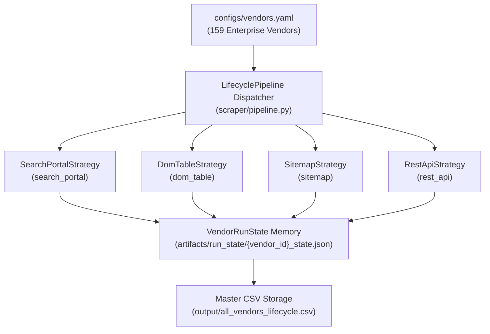

# 🌐 Strategy-Pattern Config-Driven Architecture & Vendor Lifecycle Registry

## 🏗️ 1. Strategy-Pattern Config-Driven Architecture

The Multi-Vendor AI Scraper decouples crawler execution logic from vendor-specific configuration via a **pluggable Strategy Pattern**. Rather than maintaining fragile, one-off standalone scripts per manufacturer, all scraping behavior is modularized into four reusable strategy classes registered in `scraper/strategies/`:

### Pluggable Strategy Classes
| Strategy | Config Identifier | Operational Archetype | Representative Vendors | Dynamic Capabilities |
|:---|:---|:---|:---|:---|
| **`SearchPortalStrategy`** | `search_portal` / `lifecycle_search` | Parameterized search forms (`?keyword={keyword}`), CSS row extraction, live DOM hydration. | Rockwell Automation, Siemens Industry Mall, HP PartSurfer, Dell Support | **Dynamic Runtime Prefix Discovery**: Zero hardcoded keywords. Extracts family prefixes from XML sitemaps, historical seen models, and recurses on newly discovered replacement models in real-time. |
| **`DomTableStrategy`** | `dom_table` / `table` | Structured HTML and DOM table rendering with column mapping, header detection, and sanitization. | Cisco Meraki, Aruba Networks, Juniper, Veeam, Teltonika, SonicWall, Fortinet | **Header Discrimination & Quote Sanitization**: Automatically skips non-data `<th>` rows, validates real model SKUs, cleans quotation marks, and standardizes date formats. |
| **`SitemapStrategy`** | `sitemap` / `sitemap_index` | Recursive XML sitemap index traversal, product detail page (PDP) filtering, and metadata extraction. | Rockwell Automation, Schneider Electric, Phoenix Contact, Omron | **Regex Milestone Ingestion**: Recursively navigates sitemap trees, filtering catalog URLs and extracting models without LLM costs. |
| **`RestApiStrategy`** | `rest_api` / `json_api` | Direct JSON/REST lifecycle catalog ingestion and JSON-LD schema parsing. | Microsoft Learn API, Red Hat Security Data API, Cisco Support APIs | **Zero-Scraping Overhead**: Direct deserialization, deterministic field mapping, and zero token consumption. |

---

## ⚡ 2. Dynamic Runtime Prefix Discovery (Zero Hardcoding)

In previous versions, search portal queries relied on static, hardcoded prefix lists (e.g., `'1756'`, `'1769'`, `'5069'`). The Strategy Architecture completely eliminates hardcoded keywords in favor of **autonomous runtime discovery**:

1. **State Memory Harvesting**: Reads all previously verified models from `artifacts/run_state/{vendor_id}_state.json` and extracts family series prefixes using `extract_model_family_prefix()`.
2. **XML Sitemap Traversal**: Explores sitemap indexes (e.g. `sitemapindex.xml` -> `sitemap.PDP_*.xml`) on runtime and extracts discrete product family identifiers matching catalog patterns.
3. **Adaptive Recursive Expansion**: Whenever a search returns product records, newly discovered `model_name` and `replacement` SKUs (e.g., `5069-L340ER` discovered as replacement for `1756-L61`) are parsed for new prefixes and dynamically appended to the active search queue.
4. **Self-Improving Configuration**: Discovered prefixes are journaled into `metadata["discovered_prefixes"]` inside the vendor's persistent state JSON, enabling the system to retain and expand its knowledge base across runs.

---

## 🧠 3. Persistent State Memory & Error-Bound Circuit Breaking

Each vendor maintains isolated, resume-safe execution state in `artifacts/run_state/{vendor_id}_state.json`:
- **`completed_units`**: Records completed URLs, sitemaps, and search family prefixes to prevent redundant HTTP queries.
- **`seen_models`**: Tracks all harvested model names across all historical runs to guarantee cross-session deduplication.
- **`discovered_prefixes`**: Dynamically learned model prefixes discovered during crawl sessions.
- **Circuit Breaker (`max_consecutive_errors=5`)**: Automatically halts a strategy run if 5 consecutive queries fail or timeout, safely protecting network resources and routing failures to `output/crawl_failures.json`.
- **Unlimited Ingestion**: Runs continuously across all uncompleted units with `max_pages=0` and `max_depth=0`, stopping only when all queues are naturally exhausted or the circuit breaker trips.

---

## 🏷️ Complete Manufacturer-Exact Lifecycle Status Terminology Registry

Industrial automation, embedded IoT silicon, and enterprise IT hardware manufacturers **do not adhere to a single unified status vocabulary**. Each vendor defines rigorous proprietary lifecycle phases governing purchasing windows, warranty maintenance, component repair, and obsolescence.

> [!IMPORTANT]
> **Zero Dropped EOL Records Rule**: Products that have reached End of Life (EOL), Discontinued, Phase-Out, or Obsolete status **always produce an entry even if the vendor does not publish an explicit milestone date**. Missing dates will NEVER drop a record. The extractor and storage preserve all end-of-life models, tagging missing dates cleanly in metadata.

Below is the comprehensive cross-vendor status terminology catalog across **all 159 supported enterprise vendors**:

### 1. Operational Technology (OT) - Industrial Automation & Control (61 Supported Vendors)

| Vendor / Manufacturer | Official Lifecycle Phasing Model | Exact Vendor Status Terminology | Operational Definition & Impact | Trusted Lifecycle Source URL |
|:---|:---|:---|:---|:---|
| **ABB** (`abb`) | 4-Phase Lifecycle Model (Active, Classic, Limited, Obsolete) | `Active` | Full range of lifecycle services and active series production for new installations. | [new.abb.com](https://new.abb.com/drives/services/lifecycle-management) |
| **ABB** (`abb`) | 4-Phase Lifecycle Model (Active, Classic, Limited, Obsolete) | `Classic` | Enhanced services available; product is mature and successor product is actively recommended for new lines. | [new.abb.com](https://new.abb.com/drives/services/lifecycle-management) |
| **ABB** (`abb`) | 4-Phase Lifecycle Model (Active, Classic, Limited, Obsolete) | `Limited` | Manufacturing stopped. Services limited to spare parts, workshop repair, and technical advice. | [new.abb.com](https://new.abb.com/drives/services/lifecycle-management) |
| **ABB** (`abb`) | 4-Phase Lifecycle Model (Active, Classic, Limited, Obsolete) | `Obsolete` | End of lifecycle. Spares exhausted; support provided on best-effort basis only. Urgent replacement required. | [new.abb.com](https://new.abb.com/drives/services/lifecycle-management) |
| **Advantech** (`advantech`) | Official Manufacturer Lifecycle Policy | `Production Discontinuation` / `Last Time Buy (LTB)` / `End of Support (EOS)` | Manufacturer-exact milestones tracking production cessation, final procurement deadline, and complete warranty/repair termination. | [www.advantech.com](https://www.advantech.com/en/support/eol-products) |
| **B&R Industrial Automation** (`br_automation`) | Automation Lifecycle Policy | `Active` | System 2005/X20 components in standard commercial production. | [www.br-automation.com](https://www.br-automation.com/en/products/discontinued-products/) |
| **B&R Industrial Automation** (`br_automation`) | Automation Lifecycle Policy | `Phase-Out (LTB)` | Official phase-out announced; last order date scheduled. | [www.br-automation.com](https://www.br-automation.com/en/products/discontinued-products/) |
| **B&R Industrial Automation** (`br_automation`) | Automation Lifecycle Policy | `Discontinued` | Series retired; available strictly as spare part. | [www.br-automation.com](https://www.br-automation.com/en/products/discontinued-products/) |
| **B&R Industrial Automation** (`br_automation`) | Automation Lifecycle Policy | `End of Support (EOS)` | Complete support discontinued; migration to modern X20/ACOPOS advised. | [www.br-automation.com](https://www.br-automation.com/en/products/discontinued-products/) |
| **Banner Engineering** (`banner_engineering`) | Official Manufacturer Lifecycle Policy | `Production Discontinuation` / `Last Time Buy (LTB)` / `End of Support (EOS)` | Manufacturer-exact milestones tracking production cessation, final procurement deadline, and complete warranty/repair termination. | [www.bannerengineering.com](https://www.bannerengineering.com/us/en/support/discontinued-products.html) |
| **Baumuller** (`baumuller`) | Official Manufacturer Lifecycle Policy | `Production Discontinuation` / `Last Time Buy (LTB)` / `End of Support (EOS)` | Manufacturer-exact milestones tracking production cessation, final procurement deadline, and complete warranty/repair termination. | [www.baumueller.com](https://www.baumueller.com/en/service/life-cycle-management) |
| **Beckhoff Automation** (`beckhoff`) | TwinCAT & PC-Control Lifecycle | `Available` | Standard catalog series available for new systems. | [www.beckhoff.com](https://www.beckhoff.com/en-en/support/product-life-cycle/) |
| **Beckhoff Automation** (`beckhoff`) | TwinCAT & PC-Control Lifecycle | `Phase-Out (Auslauf)` | Successor released; component available for fixed transition window. | [www.beckhoff.com](https://www.beckhoff.com/en-en/support/product-life-cycle/) |
| **Beckhoff Automation** (`beckhoff`) | TwinCAT & PC-Control Lifecycle | `Discontinued (Abgekündigt)` | Orderable only as replacement/service spare part. | [www.beckhoff.com](https://www.beckhoff.com/en-en/support/product-life-cycle/) |
| **Beckhoff Automation** (`beckhoff`) | TwinCAT & PC-Control Lifecycle | `End of Service` | Obsolescence reached; repair subject to component availability. | [www.beckhoff.com](https://www.beckhoff.com/en-en/support/product-life-cycle/) |
| **Bosch** (`bosch`) | Official Manufacturer Lifecycle Policy | `Production Discontinuation` / `Last Time Buy (LTB)` / `End of Support (EOS)` | Manufacturer-exact milestones tracking production cessation, final procurement deadline, and complete warranty/repair termination. | [www.boschrexroth.com](https://www.boschrexroth.com/en/us/service-and-support/service/lifecycle-management/) |
| **Danfoss Drives** (`danfoss`) | DrivePro Lifecycle Care (Active, Classic, Limited, Inactive) | `Active` | VLT/VACON drive fully released for volume sales and standard warranty. | [www.danfoss.com](https://www.danfoss.com/en/service-and-support/drives/lifecycle-services/) |
| **Danfoss Drives** (`danfoss`) | DrivePro Lifecycle Care (Active, Classic, Limited, Inactive) | `Classic` | Successor drive series launched; drive supported for extensions and spares. | [www.danfoss.com](https://www.danfoss.com/en/service-and-support/drives/lifecycle-services/) |
| **Danfoss Drives** (`danfoss`) | DrivePro Lifecycle Care (Active, Classic, Limited, Inactive) | `Limited` | Maintenance and repairs available based on spare parts inventory. | [www.danfoss.com](https://www.danfoss.com/en/service-and-support/drives/lifecycle-services/) |
| **Danfoss Drives** (`danfoss`) | DrivePro Lifecycle Care (Active, Classic, Limited, Inactive) | `Inactive / Discontinued` | Drive retired; upgrade service recommended. | [www.danfoss.com](https://www.danfoss.com/en/service-and-support/drives/lifecycle-services/) |
| **Delta Electronics** (`delta_electronics`) | Official Manufacturer Lifecycle Policy | `Production Discontinuation` / `Last Time Buy (LTB)` / `End of Support (EOS)` | Manufacturer-exact milestones tracking production cessation, final procurement deadline, and complete warranty/repair termination. | [www.deltaww.com](https://www.deltaww.com/en-US/products/Industrial-Automation/discontinued) |
| **Dragos Industrial Cybersecurity** (`dragos`) | Official Manufacturer Lifecycle Policy | `Production Discontinuation` / `Last Time Buy (LTB)` / `End of Support (EOS)` | Manufacturer-exact milestones tracking production cessation, final procurement deadline, and complete warranty/repair termination. | [www.dragos.com](https://www.dragos.com/products/dragos-platform/) |
| **Eaton Electrical** (`eaton`) | Official Manufacturer Lifecycle Policy | `Production Discontinuation` / `Last Time Buy (LTB)` / `End of Support (EOS)` | Manufacturer-exact milestones tracking production cessation, final procurement deadline, and complete warranty/repair termination. | [www.eaton.com](https://www.eaton.com/us/en-us/support/obsolete-products.html) |
| **Emerson Electric** (`emerson`) | Official Manufacturer Lifecycle Policy | `Production Discontinuation` / `Last Time Buy (LTB)` / `End of Support (EOS)` | Manufacturer-exact milestones tracking production cessation, final procurement deadline, and complete warranty/repair termination. | [www.emerson.com](https://www.emerson.com/en-us/automation/systems-and-software/distributed-control-systems-dcs/deltav-distributed-control-system/deltav-lifecycle) |
| **Endress+Hauser** (`endress_hauser`) | Process Instrumentation Lifecycle | `Active` | Volume manufacturing of flow, level, pressure, and temperature transmitters. | [www.endress.com](https://www.endress.com/en/instrumentation-services/maintenance-services/lifecycle-management) |
| **Endress+Hauser** (`endress_hauser`) | Process Instrumentation Lifecycle | `Phased-Out` | Legacy instrument; successor designated for new process designs. | [www.endress.com](https://www.endress.com/en/instrumentation-services/maintenance-services/lifecycle-management) |
| **Endress+Hauser** (`endress_hauser`) | Process Instrumentation Lifecycle | `Discontinued` | Factory production ended; service parts supported. | [www.endress.com](https://www.endress.com/en/instrumentation-services/maintenance-services/lifecycle-management) |
| **Endress+Hauser** (`endress_hauser`) | Process Instrumentation Lifecycle | `Obsolete` | Service period ended; complete instrument replacement required. | [www.endress.com](https://www.endress.com/en/instrumentation-services/maintenance-services/lifecycle-management) |
| **FANUC Corporation** (`fanuc`) | Lifetime Maintenance Commitment Model | `Current Production` | Active controller and drive manufacturing. | [www.fanucamerica.com](https://www.fanucamerica.com/support/parts-and-repair) |
| **FANUC Corporation** (`fanuc`) | Lifetime Maintenance Commitment Model | `Discontinued` | Production stopped; lifelong repair service supported. | [www.fanucamerica.com](https://www.fanucamerica.com/support/parts-and-repair) |
| **FANUC Corporation** (`fanuc`) | Lifetime Maintenance Commitment Model | `Maintenance Limited` | Repairs dependent on component stock. | [www.fanucamerica.com](https://www.fanucamerica.com/support/parts-and-repair) |
| **Festo SE & Co. KG** (`festo`) | Pneumatic & Electric Automation Lifecycle | `Standard Core Range` | Standard valve terminal, drive, or pneumatic cylinder. | [www.festo.com](https://www.festo.com/us/en/e/support/discontinued-products-id_discontinued/) |
| **Festo SE & Co. KG** (`festo`) | Pneumatic & Electric Automation Lifecycle | `Phase-Out Product (Auslauftyp)` | Discontinuation phase active; transition to modern core product. | [www.festo.com](https://www.festo.com/us/en/e/support/discontinued-products-id_discontinued/) |
| **Festo SE & Co. KG** (`festo`) | Pneumatic & Electric Automation Lifecycle | `Discontinued Product` | Production terminated; orderable only as replacement part. | [www.festo.com](https://www.festo.com/us/en/e/support/discontinued-products-id_discontinued/) |
| **Fuji Electric** (`fuji_electric`) | Official Manufacturer Lifecycle Policy | `Production Discontinuation` / `Last Time Buy (LTB)` / `End of Support (EOS)` | Manufacturer-exact milestones tracking production cessation, final procurement deadline, and complete warranty/repair termination. | [www.fujielectric.com](https://www.fujielectric.com/products/discontinued/) |
| **GE Vernova / GE Digital** (`ge_digital`) | Official Manufacturer Lifecycle Policy | `Production Discontinuation` / `Last Time Buy (LTB)` / `End of Support (EOS)` | Manufacturer-exact milestones tracking production cessation, final procurement deadline, and complete warranty/repair termination. | [www.ge.com](https://www.ge.com/digital/support/lifecycle-policies) |
| **HMS Networks** (`hms_networks`) | Industrial Gateway & Communicator Lifecycle | `Active` | Anybus gateway or eWON remote access router in production. | [www.anybus.com](https://www.anybus.com/support/product-lifecycle) |
| **HMS Networks** (`hms_networks`) | Industrial Gateway & Communicator Lifecycle | `Phase-Out` | Last order date announced; migration product available. | [www.anybus.com](https://www.anybus.com/support/product-lifecycle) |
| **HMS Networks** (`hms_networks`) | Industrial Gateway & Communicator Lifecycle | `Discontinued` | Hardware retired; spare parts for warranty only. | [www.anybus.com](https://www.anybus.com/support/product-lifecycle) |
| **HMS Networks** (`hms_networks`) | Industrial Gateway & Communicator Lifecycle | `Obsolete` | Complete lifecycle termination. | [www.anybus.com](https://www.anybus.com/support/product-lifecycle) |
| **Hans Turck GmbH** (`turck`) | Sensor & Fieldbus Lifecycle | `Active Production` | Standard proximity switch, flow sensor, or I/O block. | [www.turck.de](https://www.turck.de/en/product-discontinuations-4433.php) |
| **Hans Turck GmbH** (`turck`) | Sensor & Fieldbus Lifecycle | `Product Discontinuation Notice` | Phase-out notification with Last Time Buy deadline. | [www.turck.de](https://www.turck.de/en/product-discontinuations-4433.php) |
| **Hans Turck GmbH** (`turck`) | Sensor & Fieldbus Lifecycle | `Discontinued` | Manufacturing concluded; spare part support active. | [www.turck.de](https://www.turck.de/en/product-discontinuations-4433.php) |
| **Hirschmann (Belden)** (`hirschmann`) | Industrial Networking Hardware Lifecycle | `Active` | Industrial managed Ethernet switch or firewall in active production. | [www.belden.com](https://www.belden.com/resources/support/product-lifecycle-status) |
| **Hirschmann (Belden)** (`hirschmann`) | Industrial Networking Hardware Lifecycle | `Phase-Out Announced` | Advance notification of upcoming discontinuation. | [www.belden.com](https://www.belden.com/resources/support/product-lifecycle-status) |
| **Hirschmann (Belden)** (`hirschmann`) | Industrial Networking Hardware Lifecycle | `Last Time Buy (LTB)` | Final order cutoff date for hardware procurement. | [www.belden.com](https://www.belden.com/resources/support/product-lifecycle-status) |
| **Hirschmann (Belden)** (`hirschmann`) | Industrial Networking Hardware Lifecycle | `End of Life (EOL)` | Complete production and firmware maintenance terminated. | [www.belden.com](https://www.belden.com/resources/support/product-lifecycle-status) |
| **Hitachi** (`hitachi`) | Official Manufacturer Lifecycle Policy | `Production Discontinuation` / `Last Time Buy (LTB)` / `End of Support (EOS)` | Manufacturer-exact milestones tracking production cessation, final procurement deadline, and complete warranty/repair termination. | [www.hitachi-ies.co.jp](https://www.hitachi-ies.co.jp/english/products/discon/index.htm) |
| **Honeywell** (`honeywell`) | Official Manufacturer Lifecycle Policy | `Production Discontinuation` / `Last Time Buy (LTB)` / `End of Support (EOS)` | Manufacturer-exact milestones tracking production cessation, final procurement deadline, and complete warranty/repair termination. | [process.honeywell.com](https://process.honeywell.com/us/en/services/lifecycle-support) |
| **IDEC Corporation** (`idec`) | Official Manufacturer Lifecycle Policy | `Production Discontinuation` / `Last Time Buy (LTB)` / `End of Support (EOS)` | Manufacturer-exact milestones tracking production cessation, final procurement deadline, and complete warranty/repair termination. | [us.idec.com](https://us.idec.com/idec-us/en/USD/discontinued-products) |
| **JTEKT Toyoda (JTEKT Electronics)** (`toyoda`) | JTEKT Electronics & TOYOPUC Lifecycle Timeline | `Standard Production` | Current generation TOYOPUC PAC/PLC series and electronic equipment in active production. | [www.electronics.jtekt.co.jp](https://www.electronics.jtekt.co.jp/en/product/discon/) |
| **JTEKT Toyoda (JTEKT Electronics)** (`toyoda`) | JTEKT Electronics & TOYOPUC Lifecycle Timeline | `Discontinuation Notification` | Advance manufacturer notice indicating scheduled production cutoff and transition plan. | [www.electronics.jtekt.co.jp](https://www.electronics.jtekt.co.jp/en/product/discon/) |
| **JTEKT Toyoda (JTEKT Electronics)** (`toyoda`) | JTEKT Electronics & TOYOPUC Lifecycle Timeline | `Discontinued Model (生産終了)` | Manufacturing concluded; guaranteed spare parts and maintenance support period begins. | [www.electronics.jtekt.co.jp](https://www.electronics.jtekt.co.jp/en/product/discon/) |
| **JTEKT Toyoda (JTEKT Electronics)** (`toyoda`) | JTEKT Electronics & TOYOPUC Lifecycle Timeline | `Maintenance / Repair Period (修理対応期間)` | Repair services and spare parts supported according to parts availability (typically 7 years post-discontinuation). | [www.electronics.jtekt.co.jp](https://www.electronics.jtekt.co.jp/en/product/discon/) |
| **JTEKT Toyoda (JTEKT Electronics)** (`toyoda`) | JTEKT Electronics & TOYOPUC Lifecycle Timeline | `End of Maintenance (修理対応終了)` | Repair support ceased; migration to modern replacement series (e.g. TOYOPUC-Plus, DL06) required. | [www.electronics.jtekt.co.jp](https://www.electronics.jtekt.co.jp/en/product/discon/) |
| **Keyence Corporation** (`keyence`) | Sensor & Vision Discontinuation Schedule | `Standard Catalog` | Current sensor, safety light curtain, or measurement system. | [www.keyence.com](https://www.keyence.com/support/user/discontinued/) |
| **Keyence Corporation** (`keyence`) | Sensor & Vision Discontinuation Schedule | `Discontinuation Announced` | Bulletin published indicating upcoming order deadline. | [www.keyence.com](https://www.keyence.com/support/user/discontinued/) |
| **Keyence Corporation** (`keyence`) | Sensor & Vision Discontinuation Schedule | `Discontinued (生産終了)` | Production ended; successor model recommended. | [www.keyence.com](https://www.keyence.com/support/user/discontinued/) |
| **Keyence Corporation** (`keyence`) | Sensor & Vision Discontinuation Schedule | `Repair Period Expired` | 7-year service concluded; maintenance no longer possible. | [www.keyence.com](https://www.keyence.com/support/user/discontinued/) |
| **Kuka Robotics** (`kuka`) | Official Manufacturer Lifecycle Policy | `Production Discontinuation` / `Last Time Buy (LTB)` / `End of Support (EOS)` | Manufacturer-exact milestones tracking production cessation, final procurement deadline, and complete warranty/repair termination. | [www.kuka.com](https://www.kuka.com/en-us/services/customer-service/spare-parts) |
| **Lenze** (`lenze`) | Official Manufacturer Lifecycle Policy | `Production Discontinuation` / `Last Time Buy (LTB)` / `End of Support (EOS)` | Manufacturer-exact milestones tracking production cessation, final procurement deadline, and complete warranty/repair termination. | [www.lenze.com](https://www.lenze.com/en-de/service/lifecycle-management/discontinued-products/) |
| **Mitsubishi Electric** (`mitsubishi`) | Production to Repair Termination (7-Year Maintenance) | `Active / Current Production` | Standard series catalog offering. | [se-fa.mitsubishielectric.com](https://se-fa.mitsubishielectric.com/fa/se_en/support/product-life-cycle-stage-eol) |
| **Mitsubishi Electric** (`mitsubishi`) | Production to Repair Termination (7-Year Maintenance) | `Discontinuation Announced` | Technical bulletin published with Last Time Buy deadline and successor model. | [se-fa.mitsubishielectric.com](https://se-fa.mitsubishielectric.com/fa/se_en/support/product-life-cycle-stage-eol) |
| **Mitsubishi Electric** (`mitsubishi`) | Production to Repair Termination (7-Year Maintenance) | `Discontinued (製造中止 / 生産終了)` | Production ended; new equipment orders no longer accepted. | [se-fa.mitsubishielectric.com](https://se-fa.mitsubishielectric.com/fa/se_en/support/product-life-cycle-stage-eol) |
| **Mitsubishi Electric** (`mitsubishi`) | Production to Repair Termination (7-Year Maintenance) | `Repair Termination (修理対応終了)` | 7-year spare parts supply and workshop repair service period concluded. | [se-fa.mitsubishielectric.com](https://se-fa.mitsubishielectric.com/fa/se_en/support/product-life-cycle-stage-eol) |
| **Moog Industrial** (`moog`) | Official Manufacturer Lifecycle Policy | `Production Discontinuation` / `Last Time Buy (LTB)` / `End of Support (EOS)` | Manufacturer-exact milestones tracking production cessation, final procurement deadline, and complete warranty/repair termination. | [www.moog.com](https://www.moog.com/products/servovalves-servo-proportional-valves.html) |
| **Moxa Technologies** (`moxa`) | Industrial Networking 5-Year Maintenance Policy | `Active` | Active network switch, router, or serial gateway. | [www.moxa.com](https://www.moxa.com/en/support/product-support/product-lifecycle) |
| **Moxa Technologies** (`moxa`) | Industrial Networking 5-Year Maintenance Policy | `Phase-Out Announced` | Last-time buy date communicated. | [www.moxa.com](https://www.moxa.com/en/support/product-support/product-lifecycle) |
| **Moxa Technologies** (`moxa`) | Industrial Networking 5-Year Maintenance Policy | `Discontinued (EOL)` | Product line retired; replacement model designated. | [www.moxa.com](https://www.moxa.com/en/support/product-support/product-lifecycle) |
| **Moxa Technologies** (`moxa`) | Industrial Networking 5-Year Maintenance Policy | `End of Service (EOS)` | Full support window elapsed; hardware decommissioned. | [www.moxa.com](https://www.moxa.com/en/support/product-support/product-lifecycle) |
| **National Instruments** (`national_instruments`) | Official Manufacturer Lifecycle Policy | `Production Discontinuation` / `Last Time Buy (LTB)` / `End of Support (EOS)` | Manufacturer-exact milestones tracking production cessation, final procurement deadline, and complete warranty/repair termination. | [www.ni.com](https://www.ni.com/en/support/documentation/supplemental/18/product-life-cycle-policies.html) |
| **Nidec Control Techniques** (`nidec_control_techniques`) | Official Manufacturer Lifecycle Policy | `Production Discontinuation` / `Last Time Buy (LTB)` / `End of Support (EOS)` | Manufacturer-exact milestones tracking production cessation, final procurement deadline, and complete warranty/repair termination. | [acim.nidec.com](https://acim.nidec.com/drives/control-techniques/support/legacy-products) |
| **Omron Corporation** (`omron`) | Manufacturing to Maintenance Transition Lifecycle | `Active Production` | Standard catalog model in volume production. | [ia.omron.com](https://ia.omron.com/support/discontinued/) |
| **Omron Corporation** (`omron`) | Manufacturing to Maintenance Transition Lifecycle | `Production Discontinuation Announced (生産終了予告)` | Formal circular issued communicating the final order deadline (Last Time Buy). | [ia.omron.com](https://ia.omron.com/support/discontinued/) |
| **Omron Corporation** (`omron`) | Manufacturing to Maintenance Transition Lifecycle | `Discontinued (生産終了 / 製造中止)` | Factory production has permanently terminated. | [ia.omron.com](https://ia.omron.com/support/discontinued/) |
| **Omron Corporation** (`omron`) | Manufacturing to Maintenance Transition Lifecycle | `Maintenance / Repair Termination (修理対応終了)` | 7-year post-discontinuation repair window expired; maintenance support ceased. | [ia.omron.com](https://ia.omron.com/support/discontinued/) |
| **Panasonic** (`panasonic`) | Official Manufacturer Lifecycle Policy | `Production Discontinuation` / `Last Time Buy (LTB)` / `End of Support (EOS)` | Manufacturer-exact milestones tracking production cessation, final procurement deadline, and complete warranty/repair termination. | [industrial.panasonic.com](https://industrial.panasonic.com/ac/e/fasys/component/discontinue/index.jsp) |
| **Parker Hannifin** (`parker_hannifin`) | Official Manufacturer Lifecycle Policy | `Production Discontinuation` / `Last Time Buy (LTB)` / `End of Support (EOS)` | Manufacturer-exact milestones tracking production cessation, final procurement deadline, and complete warranty/repair termination. | [www.parker.com](https://www.parker.com/us/en/support/electromechanical-legacy-products.html) |
| **Pepperl+Fuchs** (`pepperl_fuchs`) | Industrial Sensor & Ex-Protection Lifecycle | `Standard Device` | Intrinsically safe barrier or industrial sensor in active production. | [www.pepperl-fuchs.com](https://www.pepperl-fuchs.com/global/en/4405.htm) |
| **Pepperl+Fuchs** (`pepperl_fuchs`) | Industrial Sensor & Ex-Protection Lifecycle | `Phase-Out Article` | Announcement published with order cutoff date. | [www.pepperl-fuchs.com](https://www.pepperl-fuchs.com/global/en/4405.htm) |
| **Pepperl+Fuchs** (`pepperl_fuchs`) | Industrial Sensor & Ex-Protection Lifecycle | `Discontinued (Abgekündigt)` | Device retired; successor model specified. | [www.pepperl-fuchs.com](https://www.pepperl-fuchs.com/global/en/4405.htm) |
| **Phoenix Contact** (`phoenix_contact`) | Standard to Auslaufartikel Model | `Standard Article` | Full availability and standard series production. | [www.phoenixcontact.com](https://www.phoenixcontact.com/en-pc/support/discontinued-products) |
| **Phoenix Contact** (`phoenix_contact`) | Standard to Auslaufartikel Model | `Discontinued Item (Auslaufartikel)` | Notification issued with final ordering deadline and designated successor. | [www.phoenixcontact.com](https://www.phoenixcontact.com/en-pc/support/discontinued-products) |
| **Phoenix Contact** (`phoenix_contact`) | Standard to Auslaufartikel Model | `Discontinued` | Production ceased; replacement article assigned. | [www.phoenixcontact.com](https://www.phoenixcontact.com/en-pc/support/discontinued-products) |
| **Pilz Automation Safety** (`pilz`) | Safe Automation Lifecycle | `Available` | PNOZ safety relay or PSS 4000 controller in active production. | [www.pilz.com](https://www.pilz.com/en-INT/support/product-lifecycle) |
| **Pilz Automation Safety** (`pilz`) | Safe Automation Lifecycle | `Phase-Out Announced` | Transition window active; last-time buy orders accepted. | [www.pilz.com](https://www.pilz.com/en-INT/support/product-lifecycle) |
| **Pilz Automation Safety** (`pilz`) | Safe Automation Lifecycle | `Discontinued` | Part retired; warranty repairs only. | [www.pilz.com](https://www.pilz.com/en-INT/support/product-lifecycle) |
| **Pilz Automation Safety** (`pilz`) | Safe Automation Lifecycle | `Service Concluded` | Support terminated; migration to PNOZmulti 2 recommended. | [www.pilz.com](https://www.pilz.com/en-INT/support/product-lifecycle) |
| **Pro-face** (`pro_face`) | Official Manufacturer Lifecycle Policy | `Production Discontinuation` / `Last Time Buy (LTB)` / `End of Support (EOS)` | Manufacturer-exact milestones tracking production cessation, final procurement deadline, and complete warranty/repair termination. | [www.pro-face.com](https://www.pro-face.com/otasuke/download/replace/) |
| **Red Lion Controls** (`red_lion`) | HMI & Industrial Gateway Lifecycle | `Active Production` | Crimson HMI, cellular router, or panel meter in volume sales. | [www.redlion.net](https://www.redlion.net/support/product-bulletins/hardware-lifecycle) |
| **Red Lion Controls** (`red_lion`) | HMI & Industrial Gateway Lifecycle | `Phase-Out / Last-Time-Buy` | Order cutoff window communicated. | [www.redlion.net](https://www.redlion.net/support/product-bulletins/hardware-lifecycle) |
| **Red Lion Controls** (`red_lion`) | HMI & Industrial Gateway Lifecycle | `Discontinued` | Unit retired; migration path to modern series specified. | [www.redlion.net](https://www.redlion.net/support/product-bulletins/hardware-lifecycle) |
| **Rockwell Automation (Allen-Bradley)** (`rockwell_automation`) | 4-Phase Lifecycle (Active, Active Mature, End of Life, Discontinued) | `Active` | Most current hardware/software offering within a product category; fully available for new designs. | [www.rockwellautomation.com](https://www.rockwellautomation.com/en-us/support/documentation/overview/lifecycle-status.html) |
| **Rockwell Automation (Allen-Bradley)** (`rockwell_automation`) | 4-Phase Lifecycle (Active, Active Mature, End of Life, Discontinued) | `Active Mature` | Product is actively manufactured and supported, but a newer generation or migration target exists. | [www.rockwellautomation.com](https://www.rockwellautomation.com/en-us/support/documentation/overview/lifecycle-status.html) |
| **Rockwell Automation (Allen-Bradley)** (`rockwell_automation`) | 4-Phase Lifecycle (Active, Active Mature, End of Life, Discontinued) | `End of Life` | Discontinuation date announced. Final orders accepted until published Last Time Buy (LTB) date. | [www.rockwellautomation.com](https://www.rockwellautomation.com/en-us/support/documentation/overview/lifecycle-status.html) |
| **Rockwell Automation (Allen-Bradley)** (`rockwell_automation`) | 4-Phase Lifecycle (Active, Active Mature, End of Life, Discontinued) | `Discontinued` | No longer manufactured. Repair services, remanufactured parts, and technical assistance available while parts inventory lasts. | [www.rockwellautomation.com](https://www.rockwellautomation.com/en-us/support/documentation/overview/lifecycle-status.html) |
| **SICK Sensor Intelligence** (`sick`) | Sensor Intelligence Lifecycle Timeline | `Active Product` | LiDAR, photoelectric sensor, or encoder in series production. | [www.sick.com](https://www.sick.com/de/en/service-and-support/discontinued-products/w/discontinued/) |
| **SICK Sensor Intelligence** (`sick`) | Sensor Intelligence Lifecycle Timeline | `Discontinuation Notice` | Last Time Buy bulletin communicated. | [www.sick.com](https://www.sick.com/de/en/service-and-support/discontinued-products/w/discontinued/) |
| **SICK Sensor Intelligence** (`sick`) | Sensor Intelligence Lifecycle Timeline | `Discontinued` | Hardware retired; spare parts supplied while stock lasts. | [www.sick.com](https://www.sick.com/de/en/service-and-support/discontinued-products/w/discontinued/) |
| **SICK Sensor Intelligence** (`sick`) | Sensor Intelligence Lifecycle Timeline | `End of Repair Service` | Maintenance window concluded; upgrade to modern sensor. | [www.sick.com](https://www.sick.com/de/en/service-and-support/discontinued-products/w/discontinued/) |
| **SMC Corporation** (`smc`) | Official Manufacturer Lifecycle Policy | `Production Discontinuation` / `Last Time Buy (LTB)` / `End of Support (EOS)` | Manufacturer-exact milestones tracking production cessation, final procurement deadline, and complete warranty/repair termination. | [www.smcworld.com](https://www.smcworld.com/discon/en/) |
| **Schneider Electric** (`schneider_electric`) | Multi-Phase Commercial & Support Timeline | `Commercialised` | Active commercial product available for quotes, orders, and routine warranty maintenance. | [www.se.com](https://www.se.com/ww/en/work/support/resources-and-tools/product-end-of-life/) |
| **Schneider Electric** (`schneider_electric`) | Multi-Phase Commercial & Support Timeline | `End of Commercialisation (EoC)` | Commercial sales window closed; final deliveries executed. Corresponds to Last Time Buy. | [www.se.com](https://www.se.com/ww/en/work/support/resources-and-tools/product-end-of-life/) |
| **Schneider Electric** (`schneider_electric`) | Multi-Phase Commercial & Support Timeline | `End of Standard Support` | Standard software/firmware bug fixes, driver releases, and routine technical phone support expire. | [www.se.com](https://www.se.com/ww/en/work/support/resources-and-tools/product-end-of-life/) |
| **Schneider Electric** (`schneider_electric`) | Multi-Phase Commercial & Support Timeline | `End of Extended Support / Obsolescence` | No repairs, spare parts, or hardware warranty available. Migration to modern platform required. | [www.se.com](https://www.se.com/ww/en/work/support/resources-and-tools/product-end-of-life/) |
| **Shibaura Machine (Toshiba Machine)** (`shibaura_machine`) | Official Manufacturer Lifecycle Policy | `Production Discontinuation` / `Last Time Buy (LTB)` / `End of Support (EOS)` | Manufacturer-exact milestones tracking production cessation, final procurement deadline, and complete warranty/repair termination. | [www.shibaura-machine.co.jp](https://www.shibaura-machine.co.jp/en/product/robot/) |
| **Siemens** (`siemens`) | 4-Stage Milestone Lifecycle (Lieferfreigabe to Lieferstopp) | `Delivery Release (Lieferfreigabe)` | Official market launch; volume series production and active ordering. | [support.industry.siemens.com](https://support.industry.siemens.com/cs/ww/en/ps) |
| **Siemens** (`siemens`) | 4-Stage Milestone Lifecycle (Lieferfreigabe to Lieferstopp) | `Phase-Out Product (Auslauftyp / Auslaufphase)` | Active phase-out notice issued. Product remains orderable as new for standard 1 to 2 years while migration begins. | [support.industry.siemens.com](https://support.industry.siemens.com/cs/ww/en/ps) |
| **Siemens** (`siemens`) | 4-Stage Milestone Lifecycle (Lieferfreigabe to Lieferstopp) | `Product Cancellation (Produktabkündigung)` | Active production stopped. Parts supplied primarily as spare parts (Ersatzteil); engineering updates frozen. | [support.industry.siemens.com](https://support.industry.siemens.com/cs/ww/en/ps) |
| **Siemens** (`siemens`) | 4-Stage Milestone Lifecycle (Lieferfreigabe to Lieferstopp) | `Product Discontinuation (Lieferstopp / Einstellung der Ersatzteilieferung)` | Complete discontinuation. Spare part deliveries and manufacturer repairs terminated; legacy obsolescence. | [support.industry.siemens.com](https://support.industry.siemens.com/cs/ww/en/ps) |
| **Unitronics** (`unitronics`) | Official Manufacturer Lifecycle Policy | `Production Discontinuation` / `Last Time Buy (LTB)` / `End of Support (EOS)` | Manufacturer-exact milestones tracking production cessation, final procurement deadline, and complete warranty/repair termination. | [www.unitronicsplc.com](https://www.unitronicsplc.com/support-discontinued-products/) |
| **Valmet Automation** (`valmet`) | Official Manufacturer Lifecycle Policy | `Production Discontinuation` / `Last Time Buy (LTB)` / `End of Support (EOS)` | Manufacturer-exact milestones tracking production cessation, final procurement deadline, and complete warranty/repair termination. | [www.valmet.com](https://www.valmet.com/automation/services/lifecycle-services/) |
| **WAGO Kontakttechnik** (`wago`) | WAGO-I/O-SYSTEM Product Lifecycle | `Current Portfolio` | Volume production of 750 Series controllers and I/O modules. | [www.wago.com](https://www.wago.com/global/support/discontinued-products) |
| **WAGO Kontakttechnik** (`wago`) | WAGO-I/O-SYSTEM Product Lifecycle | `Phase-Out (Auslauftyp)` | Final order placement deadline announced. | [www.wago.com](https://www.wago.com/global/support/discontinued-products) |
| **WAGO Kontakttechnik** (`wago`) | WAGO-I/O-SYSTEM Product Lifecycle | `Discontinued (Abgekündigt)` | Hardware withdrawn from catalog; spare parts period initiated. | [www.wago.com](https://www.wago.com/global/support/discontinued-products) |
| **Weidmuller Interface** (`weidmuller`) | Official Manufacturer Lifecycle Policy | `Production Discontinuation` / `Last Time Buy (LTB)` / `End of Support (EOS)` | Manufacturer-exact milestones tracking production cessation, final procurement deadline, and complete warranty/repair termination. | [www.weidmuller.com](https://www.weidmuller.com/en/service/support/discontinued_products.jsp) |
| **Yamaha Motor Robotics** (`yamaha`) | Official Manufacturer Lifecycle Policy | `Production Discontinuation` / `Last Time Buy (LTB)` / `End of Support (EOS)` | Manufacturer-exact milestones tracking production cessation, final procurement deadline, and complete warranty/repair termination. | [global.yamaha-motor.com](https://global.yamaha-motor.com/business/robot/support/discontinued/) |
| **Yaskawa Electric** (`yaskawa`) | Motoman & Inverter Lifecycle | `Standard Production` | Active drive and servo series. | [www.yaskawa.com](https://www.yaskawa.com/products/motion/sigma-series-servos/legacy-products) |
| **Yaskawa Electric** (`yaskawa`) | Motoman & Inverter Lifecycle | `Production Discontinuation` | Final order window communicated. | [www.yaskawa.com](https://www.yaskawa.com/products/motion/sigma-series-servos/legacy-products) |
| **Yaskawa Electric** (`yaskawa`) | Motoman & Inverter Lifecycle | `Support Period Expired` | Parts exhausted; replacement required. | [www.yaskawa.com](https://www.yaskawa.com/products/motion/sigma-series-servos/legacy-products) |
| **Yokogawa Electric** (`yokogawa`) | CENTUM & ProSafe-RS Lifecycle Support | `Current Product` | Active DCS/PLC hardware in active distribution. | [www.yokogawa.com](https://www.yokogawa.com/solutions/services/lifecycle-solutions/) |
| **Yokogawa Electric** (`yokogawa`) | CENTUM & ProSafe-RS Lifecycle Support | `Phased Out (LTB)` | Last Time Buy notice communicated; order cutoff specified. | [www.yokogawa.com](https://www.yokogawa.com/solutions/services/lifecycle-solutions/) |
| **Yokogawa Electric** (`yokogawa`) | CENTUM & ProSafe-RS Lifecycle Support | `Discontinued` | Production ceased; spare parts availability window begins. | [www.yokogawa.com](https://www.yokogawa.com/solutions/services/lifecycle-solutions/) |
| **Yokogawa Electric** (`yokogawa`) | CENTUM & ProSafe-RS Lifecycle Support | `Support Period Expired` | Service ended; upgrade to modern CENTUM VP required. | [www.yokogawa.com](https://www.yokogawa.com/solutions/services/lifecycle-solutions/) |
| **ifm electronic** (`ifm_electronic`) | Sensor & Control System Lifecycle | `Standard Portfolio` | Active sensor and IO-Link master range. | [www.ifm.com](https://www.ifm.com/de/en/shared/product-discontinuations) |
| **ifm electronic** (`ifm_electronic`) | Sensor & Control System Lifecycle | `Discontinued Product (Auslaufartikel)` | Scheduled withdrawal date published with successor reference. | [www.ifm.com](https://www.ifm.com/de/en/shared/product-discontinuations) |
| **ifm electronic** (`ifm_electronic`) | Sensor & Control System Lifecycle | `Replacement Recommended` | Production ended; direct 1-to-1 substitute advised. | [www.ifm.com](https://www.ifm.com/de/en/shared/product-discontinuations) |

### 2. Internet of Things (IoT) - Embedded Silicon & Connected Hardware (45 Supported Vendors)

| Vendor / Manufacturer | Official Lifecycle Phasing Model | Exact Vendor Status Terminology | Operational Definition & Impact | Trusted Lifecycle Source URL |
|:---|:---|:---|:---|:---|
| **Arduino Pro & IoT** (`arduino`) | Official Manufacturer Lifecycle Policy | `Production Discontinuation` / `Last Time Buy (LTB)` / `End of Support (EOS)` | Manufacturer-exact milestones tracking production cessation, final procurement deadline, and complete warranty/repair termination. | [www.arduino.cc](https://www.arduino.cc/en/Main/Products#retired) |
| **Avigilon (Motorola Solutions)** (`avigilon`) | Video Security & Access Control Lifecycle | `Active` | H5A camera or Access Control Manager in volume distribution. | [www.avigilon.com](https://www.avigilon.com/support/hardware-lifecycle) |
| **Avigilon (Motorola Solutions)** (`avigilon`) | Video Security & Access Control Lifecycle | `Discontinuation Notice` | Advance retirement circular published. | [www.avigilon.com](https://www.avigilon.com/support/hardware-lifecycle) |
| **Avigilon (Motorola Solutions)** (`avigilon`) | Video Security & Access Control Lifecycle | `End of Life (EOL)` | Manufacturing ended; 5-year post-EOL support active. | [www.avigilon.com](https://www.avigilon.com/support/hardware-lifecycle) |
| **Avigilon (Motorola Solutions)** (`avigilon`) | Video Security & Access Control Lifecycle | `End of Service (EOS)` | Hardware RMA and TAC service retired. | [www.avigilon.com](https://www.avigilon.com/support/hardware-lifecycle) |
| **Axis Communications** (`axis_communications`) | Network Video & Camera Lifecycle | `Active` | Network camera, video encoder, or intercom in current production. | [www.axis.com](https://www.axis.com/support/product-lifecycle) |
| **Axis Communications** (`axis_communications`) | Network Video & Camera Lifecycle | `Discontinuation Notification` | Formal phase-out announcement communicated. | [www.axis.com](https://www.axis.com/support/product-lifecycle) |
| **Axis Communications** (`axis_communications`) | Network Video & Camera Lifecycle | `Discontinued` | Final production batch manufactured; replacement model assigned. | [www.axis.com](https://www.axis.com/support/product-lifecycle) |
| **Axis Communications** (`axis_communications`) | Network Video & Camera Lifecycle | `End of Support (EOS)` | Spare parts and firmware security patches concluded. | [www.axis.com](https://www.axis.com/support/product-lifecycle) |
| **Basler AG** (`basler`) | Machine Vision Camera Discontinuation | `Standard Production` | ace, dart, or boost vision camera in volume delivery. | [www.baslerweb.com](https://www.baslerweb.com/en/products/discontinued-products/) |
| **Basler AG** (`basler`) | Machine Vision Camera Discontinuation | `Discontinuation Announced` | Last order date and last shipment date communicated. | [www.baslerweb.com](https://www.baslerweb.com/en/products/discontinued-products/) |
| **Basler AG** (`basler`) | Machine Vision Camera Discontinuation | `Last Time Buy (LTB)` | Order cutoff reached; production begins winding down. | [www.baslerweb.com](https://www.baslerweb.com/en/products/discontinued-products/) |
| **Basler AG** (`basler`) | Machine Vision Camera Discontinuation | `End of Repair Service` | Camera maintenance period elapsed. | [www.baslerweb.com](https://www.baslerweb.com/en/products/discontinued-products/) |
| **Cognex Corporation** (`cognex`) | Official Manufacturer Lifecycle Policy | `Production Discontinuation` / `Last Time Buy (LTB)` / `End of Support (EOS)` | Manufacturer-exact milestones tracking production cessation, final procurement deadline, and complete warranty/repair termination. | [www.cognex.com](https://www.cognex.com/support/discontinued-products) |
| **Dahua Technology** (`dahua`) | Official Manufacturer Lifecycle Policy | `Production Discontinuation` / `Last Time Buy (LTB)` / `End of Support (EOS)` | Manufacturer-exact milestones tracking production cessation, final procurement deadline, and complete warranty/repair termination. | [www.dahuasecurity.com](https://www.dahuasecurity.com/support/discontinuedProducts) |
| **Digi International** (`digi_intl`) | Official Manufacturer Lifecycle Policy | `Production Discontinuation` / `Last Time Buy (LTB)` / `End of Support (EOS)` | Manufacturer-exact milestones tracking production cessation, final procurement deadline, and complete warranty/repair termination. | [www.digi.com](https://www.digi.com/support/product-lifecycle) |
| **Dragino Technology** (`dragino`) | Official Manufacturer Lifecycle Policy | `Production Discontinuation` / `Last Time Buy (LTB)` / `End of Support (EOS)` | Manufacturer-exact milestones tracking production cessation, final procurement deadline, and complete warranty/repair termination. | [www.dragino.com](https://www.dragino.com/support.html) |
| **Espressif Systems** (`espressif`) | ESP32/ESP8266 12-Year Longevity | `In Production` | ESP32, ESP32-S, ESP32-C modules in mass production. | [www.espressif.com](https://www.espressif.com/en/products/longevity-commitment) |
| **Espressif Systems** (`espressif`) | ESP32/ESP8266 12-Year Longevity | `12-Year Longevity Commitment Active` | Guaranteed minimum 12-year supply commitment from launch. | [www.espressif.com](https://www.espressif.com/en/products/longevity-commitment) |
| **Espressif Systems** (`espressif`) | ESP32/ESP8266 12-Year Longevity | `Discontinuation Notice` | Advance notice published with minimum 6-month LTB window. | [www.espressif.com](https://www.espressif.com/en/products/longevity-commitment) |
| **Eurotech Edge Gateway** (`eurotech`) | Official Manufacturer Lifecycle Policy | `Production Discontinuation` / `Last Time Buy (LTB)` / `End of Support (EOS)` | Manufacturer-exact milestones tracking production cessation, final procurement deadline, and complete warranty/repair termination. | [www.eurotech.com](https://www.eurotech.com/en/support/product-lifecycle) |
| **Hanwha Vision** (`hanwha_vision`) | Official Manufacturer Lifecycle Policy | `Production Discontinuation` / `Last Time Buy (LTB)` / `End of Support (EOS)` | Manufacturer-exact milestones tracking production cessation, final procurement deadline, and complete warranty/repair termination. | [hanwhavisionamerica.com](https://hanwhavisionamerica.com/support/discontinued-products/) |
| **Hikvision Digital Technology** (`hikvision`) | Official Manufacturer Lifecycle Policy | `Production Discontinuation` / `Last Time Buy (LTB)` / `End of Support (EOS)` | Manufacturer-exact milestones tracking production cessation, final procurement deadline, and complete warranty/repair termination. | [www.hikvision.com](https://www.hikvision.com/en/support/tools/discontinued-products/) |
| **Intel Corporation** (`intel`) | Product Discontinuation Notice (PDN) Lifecycle | `Launched` | Volume production silicon and embedded processors. | [www.intel.com](https://www.intel.com/content/www/us/en/support/articles/000022396/processors.html) |
| **Intel Corporation** (`intel`) | Product Discontinuation Notice (PDN) Lifecycle | `Product Discontinuation Notice (PDN)` | Formal notification of impending lifecycle termination. | [www.intel.com](https://www.intel.com/content/www/us/en/support/articles/000022396/processors.html) |
| **Intel Corporation** (`intel`) | Product Discontinuation Notice (PDN) Lifecycle | `Last Time Buy (LTB)` | Final date for non-cancellable, non-returnable purchase orders. | [www.intel.com](https://www.intel.com/content/www/us/en/support/articles/000022396/processors.html) |
| **Intel Corporation** (`intel`) | Product Discontinuation Notice (PDN) Lifecycle | `Last Time Ship (LTS)` | Final date for factory delivery and dispatch. | [www.intel.com](https://www.intel.com/content/www/us/en/support/articles/000022396/processors.html) |
| **Intel Corporation** (`intel`) | Product Discontinuation Notice (PDN) Lifecycle | `End of Interactive Support (EOIS)` | Technical phone/chat support, errata updates, and microcode patches frozen. | [www.intel.com](https://www.intel.com/content/www/us/en/support/articles/000022396/processors.html) |
| **Kerlink LoRaWAN** (`kerlink`) | Official Manufacturer Lifecycle Policy | `Production Discontinuation` / `Last Time Buy (LTB)` / `End of Support (EOS)` | Manufacturer-exact milestones tracking production cessation, final procurement deadline, and complete warranty/repair termination. | [www.kerlink.com](https://www.kerlink.com/support/) |
| **Kontron Embedded** (`kontron`) | Official Manufacturer Lifecycle Policy | `Production Discontinuation` / `Last Time Buy (LTB)` / `End of Support (EOS)` | Manufacturer-exact milestones tracking production cessation, final procurement deadline, and complete warranty/repair termination. | [www.kontron.com](https://www.kontron.com/en/support/product-lifecycle) |
| **Kyocera AVX** (`kyocera`) | Official Manufacturer Lifecycle Policy | `Production Discontinuation` / `Last Time Buy (LTB)` / `End of Support (EOS)` | Manufacturer-exact milestones tracking production cessation, final procurement deadline, and complete warranty/repair termination. | [www.kyoceradocumentsolutions.com](https://www.kyoceradocumentsolutions.com/support/discontinued/) |
| **Laird Connectivity** (`laird_connect`) | Official Manufacturer Lifecycle Policy | `Production Discontinuation` / `Last Time Buy (LTB)` / `End of Support (EOS)` | Manufacturer-exact milestones tracking production cessation, final procurement deadline, and complete warranty/repair termination. | [www.ezurio.com](https://www.ezurio.com/support/product-lifecycle) |
| **Libelium IoT** (`libelium`) | Official Manufacturer Lifecycle Policy | `Production Discontinuation` / `Last Time Buy (LTB)` / `End of Support (EOS)` | Manufacturer-exact milestones tracking production cessation, final procurement deadline, and complete warranty/repair termination. | [www.libelium.com](https://www.libelium.com/support/) |
| **Microchip Technology** (`microchip`) | Client-Driven Obsolescence Policy | `In Production` | PIC/AVR MCU or analog device in volume manufacturing. | [www.microchip.com](https://www.microchip.com/en-us/about/quality-and-reliability/product-change-notifications) |
| **Microchip Technology** (`microchip`) | Client-Driven Obsolescence Policy | `Not Recommended for New Designs (NRND)` | Production maintained, but modern alternative advised. | [www.microchip.com](https://www.microchip.com/en-us/about/quality-and-reliability/product-change-notifications) |
| **Microchip Technology** (`microchip`) | Client-Driven Obsolescence Policy | `End of Life (EOL)` | Notice issued only when demand declines or raw wafers exhausted. | [www.microchip.com](https://www.microchip.com/en-us/about/quality-and-reliability/product-change-notifications) |
| **Milesight** (`milesight`) | Official Manufacturer Lifecycle Policy | `Production Discontinuation` / `Last Time Buy (LTB)` / `End of Support (EOS)` | Manufacturer-exact milestones tracking production cessation, final procurement deadline, and complete warranty/repair termination. | [www.milesight.com](https://www.milesight.com/support/download/discontinued/) |
| **Mobotix AG** (`mobotix`) | Video Security Hardware Lifecycle | `Active Production` | Current IoT camera series under manufacturer warranty. | [www.mobotix.com](https://www.mobotix.com/en/support/product-lifecycle) |
| **Mobotix AG** (`mobotix`) | Video Security Hardware Lifecycle | `Discontinued Product` | Hardware sales concluded; software maintenance active. | [www.mobotix.com](https://www.mobotix.com/en/support/product-lifecycle) |
| **Mobotix AG** (`mobotix`) | Video Security Hardware Lifecycle | `End of Maintenance (EOM)` | Firmware security updates and spare parts support concluded. | [www.mobotix.com](https://www.mobotix.com/en/support/product-lifecycle) |
| **MultiTech Systems** (`multitech`) | Official Manufacturer Lifecycle Policy | `Production Discontinuation` / `Last Time Buy (LTB)` / `End of Support (EOS)` | Manufacturer-exact milestones tracking production cessation, final procurement deadline, and complete warranty/repair termination. | [www.multitech.com](https://www.multitech.com/support/product-lifecycle/) |
| **Murata Manufacturing** (`murata`) | Passive Component & Module Lifecycle | `Standard Production` | Active ceramic capacitor, filter, or connectivity module. | [www.murata.com](https://www.murata.com/en-global/support/discontinued) |
| **Murata Manufacturing** (`murata`) | Passive Component & Module Lifecycle | `Discontinuation (生産中止)` | Notice published with Last Time Buy deadline. | [www.murata.com](https://www.murata.com/en-global/support/discontinued) |
| **Murata Manufacturing** (`murata`) | Passive Component & Module Lifecycle | `Replacement Assigned` | Alternative recommended for design refresh. | [www.murata.com](https://www.murata.com/en-global/support/discontinued) |
| **NXP Semiconductors** (`nxp`) | Product Longevity Program (10-15 Years) | `Active` | i.MX applications processor or Kinetis MCU in mass production. | [www.nxp.com](https://www.nxp.com/products/product-longevity:PRDCT_LONGEVITY_HM) |
| **NXP Semiconductors** (`nxp`) | Product Longevity Program (10-15 Years) | `Product Longevity Program Active` | Guaranteed supply for minimum 10 to 15 years from launch. | [www.nxp.com](https://www.nxp.com/products/product-longevity:PRDCT_LONGEVITY_HM) |
| **NXP Semiconductors** (`nxp`) | Product Longevity Program (10-15 Years) | `End of Life (LTB)` | Discontinuation announced with minimum 12-month Last Time Buy window. | [www.nxp.com](https://www.nxp.com/products/product-longevity:PRDCT_LONGEVITY_HM) |
| **Nordic Semiconductor** (`nordic_semi`) | Official Manufacturer Lifecycle Policy | `Production Discontinuation` / `Last Time Buy (LTB)` / `End of Support (EOS)` | Manufacturer-exact milestones tracking production cessation, final procurement deadline, and complete warranty/repair termination. | [www.nordicsemi.com](https://www.nordicsemi.com/Products/Product-Longevity) |
| **Nozomi Networks** (`nozomi_networks`) | Official Manufacturer Lifecycle Policy | `Production Discontinuation` / `Last Time Buy (LTB)` / `End of Support (EOS)` | Manufacturer-exact milestones tracking production cessation, final procurement deadline, and complete warranty/repair termination. | [www.nozomi-networks.com](https://www.nozomi-networks.com/products/appliances/) |
| **Particle Industries** (`particle`) | Official Manufacturer Lifecycle Policy | `Production Discontinuation` / `Last Time Buy (LTB)` / `End of Support (EOS)` | Manufacturer-exact milestones tracking production cessation, final procurement deadline, and complete warranty/repair termination. | [docs.particle.io](https://docs.particle.io/reference/datasheets/product-lifecycle/) |
| **Philips** (`philips`) | Healthcare & Connected Device Lifecycle | `Active Commercial` | Device in standard sales and warranty coverage. | [www.philips.com](https://www.philips.com/c-dam/b2bhc/master/whitepapers/enterprise-monitoring/patient-monitoring-lifecycle-matrix.pdf) |
| **Philips** (`philips`) | Healthcare & Connected Device Lifecycle | `End of Sale (EOS)` | Device sales window closes; successor model designated. | [www.philips.com](https://www.philips.com/c-dam/b2bhc/master/whitepapers/enterprise-monitoring/patient-monitoring-lifecycle-matrix.pdf) |
| **Philips** (`philips`) | Healthcare & Connected Device Lifecycle | `End of Guaranteed Support (EGS)` | Guaranteed hardware parts and software updates conclude. | [www.philips.com](https://www.philips.com/c-dam/b2bhc/master/whitepapers/enterprise-monitoring/patient-monitoring-lifecycle-matrix.pdf) |
| **Philips** (`philips`) | Healthcare & Connected Device Lifecycle | `End of Service Life (EOSL)` | Service contracts and repair availability conclude. | [www.philips.com](https://www.philips.com/c-dam/b2bhc/master/whitepapers/enterprise-monitoring/patient-monitoring-lifecycle-matrix.pdf) |
| **Qualcomm** (`qualcomm`) | Official Manufacturer Lifecycle Policy | `Production Discontinuation` / `Last Time Buy (LTB)` / `End of Support (EOS)` | Manufacturer-exact milestones tracking production cessation, final procurement deadline, and complete warranty/repair termination. | [www.qualcomm.com](https://www.qualcomm.com/products/application/industrial-commercial/longevity-program) |
| **Quectel Wireless Solutions** (`quectel`) | IoT Module Lifecycle Policy | `Mass Production` | Standard volume delivery of LTE/5G modules. | [www.quectel.com](https://www.quectel.com/product-discontinuation-policy) |
| **Quectel Wireless Solutions** (`quectel`) | IoT Module Lifecycle Policy | `Phase-Out / NRND` | Component phase-out announced; migration module advised. | [www.quectel.com](https://www.quectel.com/product-discontinuation-policy) |
| **Quectel Wireless Solutions** (`quectel`) | IoT Module Lifecycle Policy | `Discontinued (EOL)` | Production ended; Last Time Ship concluded. | [www.quectel.com](https://www.quectel.com/product-discontinuation-policy) |
| **Raspberry Pi Ltd** (`raspberry_pi`) | Official Manufacturer Lifecycle Policy | `Production Discontinuation` / `Last Time Buy (LTB)` / `End of Support (EOS)` | Manufacturer-exact milestones tracking production cessation, final procurement deadline, and complete warranty/repair termination. | [www.raspberrypi.com](https://www.raspberrypi.com/products/#product-longevity) |
| **STMicroelectronics** (`stmicroelectronics`) | 10-Year Longevity Commitment | `Active Production` | STM32 microcontroller or power IC in volume production. | [www.st.com](https://www.st.com/content/st_com/en/about/quality-and-reliability/product-longevity.html) |
| **STMicroelectronics** (`stmicroelectronics`) | 10-Year Longevity Commitment | `10-Year Longevity Active` | Guaranteed manufacturing continuity refreshed annually. | [www.st.com](https://www.st.com/content/st_com/en/about/quality-and-reliability/product-longevity.html) |
| **STMicroelectronics** (`stmicroelectronics`) | 10-Year Longevity Commitment | `Not Recommended for New Designs (NRND)` | Supported for existing lines; newer STM32 family advised. | [www.st.com](https://www.st.com/content/st_com/en/about/quality-and-reliability/product-longevity.html) |
| **STMicroelectronics** (`stmicroelectronics`) | 10-Year Longevity Commitment | `End of Life (EOL)` | Manufacturing concluded; Last Time Buy expired. | [www.st.com](https://www.st.com/content/st_com/en/about/quality-and-reliability/product-longevity.html) |
| **Seeed Studio Industrial** (`seeed_studio`) | Official Manufacturer Lifecycle Policy | `Production Discontinuation` / `Last Time Buy (LTB)` / `End of Support (EOS)` | Manufacturer-exact milestones tracking production cessation, final procurement deadline, and complete warranty/repair termination. | [www.seeedstudio.com](https://www.seeedstudio.com/depot/index.php?main_page=page&id=20) |
| **Semtech** (`semtech`) | Official Manufacturer Lifecycle Policy | `Production Discontinuation` / `Last Time Buy (LTB)` / `End of Support (EOS)` | Manufacturer-exact milestones tracking production cessation, final procurement deadline, and complete warranty/repair termination. | [www.semtech.com](https://www.semtech.com/quality/product-discontinuance) |
| **Sensirion Environmental** (`sensirion`) | Official Manufacturer Lifecycle Policy | `Production Discontinuation` / `Last Time Buy (LTB)` / `End of Support (EOS)` | Manufacturer-exact milestones tracking production cessation, final procurement deadline, and complete warranty/repair termination. | [sensirion.com](https://sensirion.com/products/product-longevity-and-discontinuation/) |
| **Silicon Laboratories** (`silicon_labs`) | Wireless SoC & MCU Longevity | `Active` | EFR32 Wireless Gecko SoC in active production. | [www.silabs.com](https://www.silabs.com/support/quality-and-reliability/product-change-notifications) |
| **Silicon Laboratories** (`silicon_labs`) | Wireless SoC & MCU Longevity | `Longevity Commitment Active` | 10 to 15-year availability guarantee maintained. | [www.silabs.com](https://www.silabs.com/support/quality-and-reliability/product-change-notifications) |
| **Silicon Laboratories** (`silicon_labs`) | Wireless SoC & MCU Longevity | `Discontinuation Notification (PRCN)` | Final buy date published before wafer fab transition. | [www.silabs.com](https://www.silabs.com/support/quality-and-reliability/product-change-notifications) |
| **Sony Professional** (`sony`) | Official Manufacturer Lifecycle Policy | `Production Discontinuation` / `Last Time Buy (LTB)` / `End of Support (EOS)` | Manufacturer-exact milestones tracking production cessation, final procurement deadline, and complete warranty/repair termination. | [pro.sony](https://pro.sony/en_US/support-services/discontinued-products) |
| **Teledyne FLIR** (`flir`) | Thermal Imaging Hardware Lifecycle | `Active` | Thermal camera or optical sensor in commercial sales. | [www.flir.com](https://www.flir.com/support-center/product-lifecycle/) |
| **Teledyne FLIR** (`flir`) | Thermal Imaging Hardware Lifecycle | `End of Life (EOL)` | Manufacturing stopped; replacement camera designated. | [www.flir.com](https://www.flir.com/support-center/product-lifecycle/) |
| **Teledyne FLIR** (`flir`) | Thermal Imaging Hardware Lifecycle | `End of Service Life (EOSL)` | Calibration, spare parts, and warranty repair terminated. | [www.flir.com](https://www.flir.com/support-center/product-lifecycle/) |
| **Telit Cinterion** (`telit`) | Cellular IoT Module Longevity | `Active` | Cellular module in regular delivery. | [www.telit.com](https://www.telit.com/support/product-discontinuation-notices/) |
| **Telit Cinterion** (`telit`) | Cellular IoT Module Longevity | `Product Discontinuation Notice (PDN)` | Official notice published with LTB and LTS milestones. | [www.telit.com](https://www.telit.com/support/product-discontinuation-notices/) |
| **Telit Cinterion** (`telit`) | Cellular IoT Module Longevity | `Last Time Buy (LTB)` | Final order placement deadline. | [www.telit.com](https://www.telit.com/support/product-discontinuation-notices/) |
| **Telit Cinterion** (`telit`) | Cellular IoT Module Longevity | `Last Time Ship (LTS)` | Final factory shipment date. | [www.telit.com](https://www.telit.com/support/product-discontinuation-notices/) |
| **Teltonika Networks** (`teltonika`) | Official Manufacturer Lifecycle Policy | `Production Discontinuation` / `Last Time Buy (LTB)` / `End of Support (EOS)` | Manufacturer-exact milestones tracking production cessation, final procurement deadline, and complete warranty/repair termination. | [wiki.teltonika-networks.com](https://wiki.teltonika-networks.com/view/End_of_Life_(EOL)_Policy) |
| **Texas Instruments** (`texas_instruments`) | Silicon Longevity Commitment | `Active` | In volume production and recommended for new designs. | [www.ti.com](https://www.ti.com/quality-reliability-packaging-download/quality-reliability-packaging-doc.tsp) |
| **Texas Instruments** (`texas_instruments`) | Silicon Longevity Commitment | `Not Recommended for New Designs (NRND)` | Existing customers supported, but newer pin-compatible silicon advised. | [www.ti.com](https://www.ti.com/quality-reliability-packaging-download/quality-reliability-packaging-doc.tsp) |
| **Texas Instruments** (`texas_instruments`) | Silicon Longevity Commitment | `Last Time Buy (LTB)` | Final order placement deadline before wafer fab shutdown. | [www.ti.com](https://www.ti.com/quality-reliability-packaging-download/quality-reliability-packaging-doc.tsp) |
| **Texas Instruments** (`texas_instruments`) | Silicon Longevity Commitment | `Obsolete / Discontinued` | Device retired; no longer manufactured or orderable. | [www.ti.com](https://www.ti.com/quality-reliability-packaging-download/quality-reliability-packaging-doc.tsp) |
| **Uniview Technologies** (`uniview`) | Official Manufacturer Lifecycle Policy | `Production Discontinuation` / `Last Time Buy (LTB)` / `End of Support (EOS)` | Manufacturer-exact milestones tracking production cessation, final procurement deadline, and complete warranty/repair termination. | [www.uniview.com](https://www.uniview.com/Support/Download_Center/Discontinued_Products/) |
| **Verkada** (`verkada`) | Official Manufacturer Lifecycle Policy | `Production Discontinuation` / `Last Time Buy (LTB)` / `End of Support (EOS)` | Manufacturer-exact milestones tracking production cessation, final procurement deadline, and complete warranty/repair termination. | [www.verkada.com](https://www.verkada.com/legal/hardware-warranty-and-lifecycle/) |
| **Zebra Technologies** (`zebra`) | Mobile Computing & Barcode Lifecycle | `Available` | Mobile computer, RFID reader, or thermal printer in production. | [www.zebra.com](https://www.zebra.com/us/en/support-downloads/lifecycles.html) |
| **Zebra Technologies** (`zebra`) | Mobile Computing & Barcode Lifecycle | `End of Sale (EOS)` | Commercial sales cutoff date. | [www.zebra.com](https://www.zebra.com/us/en/support-downloads/lifecycles.html) |
| **Zebra Technologies** (`zebra`) | Mobile Computing & Barcode Lifecycle | `End of Engineering Support` | OS maintenance releases and security patch development frozen. | [www.zebra.com](https://www.zebra.com/us/en/support-downloads/lifecycles.html) |
| **Zebra Technologies** (`zebra`) | Mobile Computing & Barcode Lifecycle | `End of Service Life (EOSL)` | Zebra OneCare contract support and parts availability terminated. | [www.zebra.com](https://www.zebra.com/us/en/support-downloads/lifecycles.html) |
| **u-blox** (`ublox`) | Positioning & Wireless Lifecycle | `Mass Production` | GNSS receiver or Bluetooth module in full distribution. | [www.u-blox.com](https://www.u-blox.com/en/product-resources/product-change-notifications) |
| **u-blox** (`ublox`) | Positioning & Wireless Lifecycle | `End of Life (EOL)` | Product Change Notification (PCN) with LTB issued. | [www.u-blox.com](https://www.u-blox.com/en/product-resources/product-change-notifications) |
| **u-blox** (`ublox`) | Positioning & Wireless Lifecycle | `Obsolete` | Module retired permanently. | [www.u-blox.com](https://www.u-blox.com/en/product-resources/product-change-notifications) |

### 3. Enterprise IT & Networking - Infrastructure & Datacenter Systems (44 Supported Vendors)

| Vendor / Manufacturer | Official Lifecycle Phasing Model | Exact Vendor Status Terminology | Operational Definition & Impact | Trusted Lifecycle Source URL |
|:---|:---|:---|:---|:---|
| **Alcatel-Lucent Enterprise** (`alcatel_lucent_enterprise`) | Official Manufacturer Lifecycle Policy | `Production Discontinuation` / `Last Time Buy (LTB)` / `End of Support (EOS)` | Manufacturer-exact milestones tracking production cessation, final procurement deadline, and complete warranty/repair termination. | [www.al-enterprise.com](https://www.al-enterprise.com/en/support/end-of-life) |
| **Allied Telesis** (`allied_telesis`) | Official Manufacturer Lifecycle Policy | `Production Discontinuation` / `Last Time Buy (LTB)` / `End of Support (EOS)` | Manufacturer-exact milestones tracking production cessation, final procurement deadline, and complete warranty/repair termination. | [www.alliedtelesis.com](https://www.alliedtelesis.com/us/en/support/end-of-life) |
| **Apple Inc.** (`apple`) | Vintage and Obsolete Products Policy | `Active / In Warranty` | Currently distributed hardware receiving macOS, iOS, and security updates with full service. | [support.apple.com](https://support.apple.com/en-us/102772) |
| **Apple Inc.** (`apple`) | Vintage and Obsolete Products Policy | `Vintage Products` | Products distributed for more than 5 and less than 7 years ago. Hardware repair subject to parts inventory availability. | [support.apple.com](https://support.apple.com/en-us/102772) |
| **Apple Inc.** (`apple`) | Vintage and Obsolete Products Policy | `Obsolete Products` | Products discontinued for more than 7 years ago. All hardware service and parts discontinued worldwide without exception. | [support.apple.com](https://support.apple.com/en-us/102772) |
| **Arista Networks** (`arista`) | Cloud Networking Lifecycle Policy | `End-of-Sale (EOS)` | Switch chassis, line cards, or optics are retired from commercial ordering. | [www.arista.com](https://www.arista.com/en/support/product-documentation/end-of-life-policy) |
| **Arista Networks** (`arista`) | Cloud Networking Lifecycle Policy | `End-of-Software Support (EOST)` | Final maintenance release of EOS network operating system for target platform. | [www.arista.com](https://www.arista.com/en/support/product-documentation/end-of-life-policy) |
| **Arista Networks** (`arista`) | Cloud Networking Lifecycle Policy | `End-of-Life (EOL)` | Final date for TAC support, diagnostics, and RMA replacement units. | [www.arista.com](https://www.arista.com/en/support/product-documentation/end-of-life-policy) |
| **Barracuda Networks** (`barracuda_networks`) | Official Manufacturer Lifecycle Policy | `Production Discontinuation` / `Last Time Buy (LTB)` / `End of Support (EOS)` | Manufacturer-exact milestones tracking production cessation, final procurement deadline, and complete warranty/repair termination. | [www.barracuda.com](https://www.barracuda.com/legal/end-of-life) |
| **Canonical** (`canonical`) | Official Manufacturer Lifecycle Policy | `Production Discontinuation` / `Last Time Buy (LTB)` / `End of Support (EOS)` | Manufacturer-exact milestones tracking production cessation, final procurement deadline, and complete warranty/repair termination. | [ubuntu.com](https://ubuntu.com/about/release-cycle) |
| **Check Point Software** (`check_point`) | Security Appliance Support Lifecycle | `General Availability` | Security appliance in active commercial distribution. | [www.checkpoint.com](https://www.checkpoint.com/support-services/support-life-cycle-policy/) |
| **Check Point Software** (`check_point`) | Security Appliance Support Lifecycle | `End of Sale (EOS)` | Hardware platform sales window concludes. | [www.checkpoint.com](https://www.checkpoint.com/support-services/support-life-cycle-policy/) |
| **Check Point Software** (`check_point`) | Security Appliance Support Lifecycle | `End of Support (EOS)` | Technical TAC support and hotfix maintenance cease. | [www.checkpoint.com](https://www.checkpoint.com/support-services/support-life-cycle-policy/) |
| **Cisco Systems** (`cisco`) | 6-Milestone End-of-Life Policy | `End-of-Life Announcement Date` | Official bulletin published detailing the entire lifecycle timeline. | [www.cisco.com](https://www.cisco.com/c/en/us/products/eos-eol-listing.html) |
| **Cisco Systems** (`cisco`) | 6-Milestone End-of-Life Policy | `End-of-Sale Date (EoS)` | Last date to order the product through standard Cisco sales channels. | [www.cisco.com](https://www.cisco.com/c/en/us/products/eos-eol-listing.html) |
| **Cisco Systems** (`cisco`) | 6-Milestone End-of-Life Policy | `End of SW Maintenance Releases` | Final software release for maintenance bug fixes and maintenance releases. | [www.cisco.com](https://www.cisco.com/c/en/us/products/eos-eol-listing.html) |
| **Cisco Systems** (`cisco`) | 6-Milestone End-of-Life Policy | `End of Vulnerability/Security Support` | Final security and vulnerability patches released. | [www.cisco.com](https://www.cisco.com/c/en/us/products/eos-eol-listing.html) |
| **Cisco Systems** (`cisco`) | 6-Milestone End-of-Life Policy | `End of Routine Failure Analysis` | Last date hardware engineering will diagnose operational failures. | [www.cisco.com](https://www.cisco.com/c/en/us/products/eos-eol-listing.html) |
| **Cisco Systems** (`cisco`) | 6-Milestone End-of-Life Policy | `Last Date of Support (LDoS)` | Final date to receive service contracts, parts replacement, and TAC assistance. | [www.cisco.com](https://www.cisco.com/c/en/us/products/eos-eol-listing.html) |
| **Citrix Systems** (`citrix`) | Virtual Apps & Desktops Lifecycle | `Notice of Status Change (NSC)` | Official notification of impending product retirement. | [www.citrix.com](https://www.citrix.com/support/product-lifecycle/product-matrix.html) |
| **Citrix Systems** (`citrix`) | Virtual Apps & Desktops Lifecycle | `End of Maintenance (EOM)` | Product maintenance releases and security fixes frozen. | [www.citrix.com](https://www.citrix.com/support/product-lifecycle/product-matrix.html) |
| **Citrix Systems** (`citrix`) | Virtual Apps & Desktops Lifecycle | `End of Life (EOL)` | Technical support and troubleshooting assistance terminated. | [www.citrix.com](https://www.citrix.com/support/product-lifecycle/product-matrix.html) |
| **Commvault** (`commvault`) | Data Protection Platform Lifecycle | `Active Release` | Platform version supported with routine quarterly maintenance releases. | [documentation.commvault.com](https://documentation.commvault.com/2024/essential/lifecycle_policy.html) |
| **Commvault** (`commvault`) | Data Protection Platform Lifecycle | `Maintenance Only` | Bug fixes limited to critical defect hotfixes. | [documentation.commvault.com](https://documentation.commvault.com/2024/essential/lifecycle_policy.html) |
| **Commvault** (`commvault`) | Data Protection Platform Lifecycle | `End of Life (EOL)` | Support concludes; migration to newer platform release required. | [documentation.commvault.com](https://documentation.commvault.com/2024/essential/lifecycle_policy.html) |
| **D-Link** (`dlink`) | Official Manufacturer Lifecycle Policy | `Production Discontinuation` / `Last Time Buy (LTB)` / `End of Support (EOS)` | Manufacturer-exact milestones tracking production cessation, final procurement deadline, and complete warranty/repair termination. | [www.dlink.com](https://www.dlink.com/en/support/product-lifecycle) |
| **Dell Technologies** (`dell`) | Server & Storage 3-Tier Support Lifecycle | `General Availability` | Standard volume availability and ProSupport coverage. | [www.dell.com](https://www.dell.com/support/kbdoc/en-us/000185736/end-of-service-life-eosl) |
| **Dell Technologies** (`dell`) | Server & Storage 3-Tier Support Lifecycle | `End of Standard Support` | Regular software, firmware updates, and standard maintenance conclude. | [www.dell.com](https://www.dell.com/support/kbdoc/en-us/000185736/end-of-service-life-eosl) |
| **Dell Technologies** (`dell`) | Server & Storage 3-Tier Support Lifecycle | `End of Service Life (EOSL)` | Hardware maintenance contracts, firmware releases, and parts support conclude. | [www.dell.com](https://www.dell.com/support/kbdoc/en-us/000185736/end-of-service-life-eosl) |
| **Extreme Networks** (`extreme_networks`) | ExtremeCloud & Switching Lifecycle | `End of Sale (EOS)` | Final order placement deadline for hardware. | [www.extremenetworks.com](https://www.extremenetworks.com/support/policies/end-of-life-policy/) |
| **Extreme Networks** (`extreme_networks`) | ExtremeCloud & Switching Lifecycle | `End of Software Maintenance (EOSM)` | ExtremeXOS / VOSS bug fixes and patches conclude. | [www.extremenetworks.com](https://www.extremenetworks.com/support/policies/end-of-life-policy/) |
| **Extreme Networks** (`extreme_networks`) | ExtremeCloud & Switching Lifecycle | `End of Service Life (EOSL)` | Technical phone assistance and RMA service expire. | [www.extremenetworks.com](https://www.extremenetworks.com/support/policies/end-of-life-policy/) |
| **F5 Networks** (`f5_networks`) | BIG-IP Platform & Software Lifecycle | `End of Sale (EoS)` | BIG-IP hardware appliance or VIPRION blade sales window closes. | [my.f5.com](https://my.f5.com/manage/s/article/K8986) |
| **F5 Networks** (`f5_networks`) | BIG-IP Platform & Software Lifecycle | `End of Software Development (EoSD)` | TMOS operating system development and maintenance releases frozen. | [my.f5.com](https://my.f5.com/manage/s/article/K8986) |
| **F5 Networks** (`f5_networks`) | BIG-IP Platform & Software Lifecycle | `End of Technical Support (EoTS)` | Customer support and diagnosis transition to best-effort guidance. | [my.f5.com](https://my.f5.com/manage/s/article/K8986) |
| **F5 Networks** (`f5_networks`) | BIG-IP Platform & Software Lifecycle | `End of Support (EoS)` | Complete hardware TAC support and repair RMA concluded. | [my.f5.com](https://my.f5.com/manage/s/article/K8986) |
| **Fluke Networks** (`fluke_networks`) | Official Manufacturer Lifecycle Policy | `Production Discontinuation` / `Last Time Buy (LTB)` / `End of Support (EOS)` | Manufacturer-exact milestones tracking production cessation, final procurement deadline, and complete warranty/repair termination. | [www.flukenetworks.com](https://www.flukenetworks.com/knowledge-base/obsolete-products) |
| **Fortinet** (`fortinet`) | FortiGate & FortiOS 3-Stage Lifecycle | `End of Order (EOO)` | Final purchase order cutoff for firewall appliance or security subscription. | [support.fortinet.com](https://support.fortinet.com/Information/ProductLifeCycle.aspx) |
| **Fortinet** (`fortinet`) | FortiGate & FortiOS 3-Stage Lifecycle | `End of Engineering Support (EOES)` | Operating system maintenance releases and vulnerability patches frozen. | [support.fortinet.com](https://support.fortinet.com/Information/ProductLifeCycle.aspx) |
| **Fortinet** (`fortinet`) | FortiGate & FortiOS 3-Stage Lifecycle | `End of Support (EOS)` | Complete technical TAC support retired; hardware unit decommissioned. | [support.fortinet.com](https://support.fortinet.com/Information/ProductLifeCycle.aspx) |
| **Hewlett Packard Enterprise** (`hpe`) | Server & Networking 5-Year Post-Sales Support | `Active Availability` | Standard commercial availability and full Pointnext warranty support. | [www.arubanetworks.com](https://www.arubanetworks.com/support-services/end-of-life/) |
| **Hewlett Packard Enterprise** (`hpe`) | Server & Networking 5-Year Post-Sales Support | `End of Sale (EOS)` | Commercial sales window closed; server, switch, or storage unit no longer orderable. | [www.arubanetworks.com](https://www.arubanetworks.com/support-services/end-of-life/) |
| **Hewlett Packard Enterprise** (`hpe`) | Server & Networking 5-Year Post-Sales Support | `End of Engineering Support (EOES)` | Operating system maintenance releases, SPP bundles, and driver updates frozen. | [www.arubanetworks.com](https://www.arubanetworks.com/support-services/end-of-life/) |
| **Hewlett Packard Enterprise** (`hpe`) | Server & Networking 5-Year Post-Sales Support | `End of Service Life (EOSL)` | Complete termination of hardware support and maintenance contracts. | [www.arubanetworks.com](https://www.arubanetworks.com/support-services/end-of-life/) |
| **Huawei** (`huawei`) | Official Manufacturer Lifecycle Policy | `Production Discontinuation` / `Last Time Buy (LTB)` / `End of Support (EOS)` | Manufacturer-exact milestones tracking production cessation, final procurement deadline, and complete warranty/repair termination. | [e.huawei.com](https://e.huawei.com/en/services/product-lifecycle) |
| **IBM Systems** (`ibm`) | Power & Mainframe Hardware Lifecycle | `General Availability` | Active Power Systems or IBM Z hardware sales. | [www.ibm.com](https://www.ibm.com/support/pages/lifecycle/) |
| **IBM Systems** (`ibm`) | Power & Mainframe Hardware Lifecycle | `Withdrawal from Marketing` | Product is withdrawn from marketing channels. | [www.ibm.com](https://www.ibm.com/support/pages/lifecycle/) |
| **IBM Systems** (`ibm`) | Power & Mainframe Hardware Lifecycle | `End of Service (EOS)` | IBM hardware maintenance and technical support expire. | [www.ibm.com](https://www.ibm.com/support/pages/lifecycle/) |
| **IGEL Technology** (`igel`) | Thin Client & OS Lifecycle Policy | `Active Sales` | UD Series thin client or IGEL OS license in active distribution. | [kb.igel.com](https://kb.igel.com/hardware/en/end-of-life-maintenance-and-support-10331006.html) |
| **IGEL Technology** (`igel`) | Thin Client & OS Lifecycle Policy | `End of Sale (EOS)` | Final date hardware is commercially available for order. | [kb.igel.com](https://kb.igel.com/hardware/en/end-of-life-maintenance-and-support-10331006.html) |
| **IGEL Technology** (`igel`) | Thin Client & OS Lifecycle Policy | `End of Maintenance (EOM)` | Firmware releases and feature enhancement updates concluded. | [kb.igel.com](https://kb.igel.com/hardware/en/end-of-life-maintenance-and-support-10331006.html) |
| **IGEL Technology** (`igel`) | Thin Client & OS Lifecycle Policy | `End of Life (EOL) / End of Support` | Complete hardware repair service and technical support terminated. | [kb.igel.com](https://kb.igel.com/hardware/en/end-of-life-maintenance-and-support-10331006.html) |
| **Juniper Networks** (`juniper`) | Junos & Routing Platform Lifecycle | `End of Life Announcement (EOA)` | Formal circular detailing final order milestones and replacement models. | [support.juniper.net](https://support.juniper.net/support/eol/) |
| **Juniper Networks** (`juniper`) | Junos & Routing Platform Lifecycle | `End of Sale (EOS)` | Final date router, switch, or firewall is orderable. | [support.juniper.net](https://support.juniper.net/support/eol/) |
| **Juniper Networks** (`juniper`) | Junos & Routing Platform Lifecycle | `End of Engineering Support (EOE)` | Junos OS maintenance releases and service releases frozen. | [support.juniper.net](https://support.juniper.net/support/eol/) |
| **Juniper Networks** (`juniper`) | Junos & Routing Platform Lifecycle | `End of Support (EOS)` | Final date JTAC technical assistance and RMA parts replacement are provided. | [support.juniper.net](https://support.juniper.net/support/eol/) |
| **Lenovo** (`lenovo`) | ThinkSystem & Datacenter Support Lifecycle | `Available` | ThinkSystem server, storage, or switch in active distribution. | [datacentersupport.lenovo.com](https://datacentersupport.lenovo.com/us/en/solutions/end-of-service-list) |
| **Lenovo** (`lenovo`) | ThinkSystem & Datacenter Support Lifecycle | `End of Life (EOL)` | System withdrawn from marketing. | [datacentersupport.lenovo.com](https://datacentersupport.lenovo.com/us/en/solutions/end-of-service-list) |
| **Lenovo** (`lenovo`) | ThinkSystem & Datacenter Support Lifecycle | `End of Service (EOS)` | Hardware maintenance and warranty service concluded. | [datacentersupport.lenovo.com](https://datacentersupport.lenovo.com/us/en/solutions/end-of-service-list) |
| **Microsoft** (`microsoft`) | Fixed & Modern Lifecycle Policy | `Mainstream Support` | Standard 5-year window with incident support, security updates, and feature changes. | [learn.microsoft.com](https://learn.microsoft.com/en-us/lifecycle/products/) |
| **Microsoft** (`microsoft`) | Fixed & Modern Lifecycle Policy | `Extended Support` | Follows mainstream support; includes security updates at no cost, non-security updates with paid agreement. | [learn.microsoft.com](https://learn.microsoft.com/en-us/lifecycle/products/) |
| **Microsoft** (`microsoft`) | Fixed & Modern Lifecycle Policy | `End of Support (EOS)` | No further updates, security patches, or technical support provided. | [learn.microsoft.com](https://learn.microsoft.com/en-us/lifecycle/products/) |
| **Microsoft** (`microsoft`) | Fixed & Modern Lifecycle Policy | `Extended Security Updates (ESU)` | Critical/important security patches for legacy operating systems on an annual subscription basis. | [learn.microsoft.com](https://learn.microsoft.com/en-us/lifecycle/products/) |
| **NETGEAR Business** (`netgear_business`) | Official Manufacturer Lifecycle Policy | `Production Discontinuation` / `Last Time Buy (LTB)` / `End of Support (EOS)` | Manufacturer-exact milestones tracking production cessation, final procurement deadline, and complete warranty/repair termination. | [www.netgear.com](https://www.netgear.com/about/eol-policy/) |
| **NetApp Storage Systems** (`netapp`) | ONTAP & Hardware Lifecycle | `Available` | Active FAS, AFF, or E-Series enterprise storage array. | [mysupport.netapp.com](https://mysupport.netapp.com/info/web/ECMP1112260.html) |
| **NetApp Storage Systems** (`netapp`) | ONTAP & Hardware Lifecycle | `End of Availability (EOA)` | Final date array or shelf is orderable as new. | [mysupport.netapp.com](https://mysupport.netapp.com/info/web/ECMP1112260.html) |
| **NetApp Storage Systems** (`netapp`) | ONTAP & Hardware Lifecycle | `End of Support (EOS)` | Complete hardware maintenance and disk replacement cease. | [mysupport.netapp.com](https://mysupport.netapp.com/info/web/ECMP1112260.html) |
| **Nutanix HCI** (`nutanix`) | Nutanix Hardware & Software Lifecycle | `General Availability` | AOS/AHV release supported with full maintenance updates. | [www.nutanix.com](https://www.nutanix.com/support-services/product-support/lifecycle-policy) |
| **Nutanix HCI** (`nutanix`) | Nutanix Hardware & Software Lifecycle | `End of Life (EOL)` | Product reached end of production or development cycle. | [www.nutanix.com](https://www.nutanix.com/support-services/product-support/lifecycle-policy) |
| **Nutanix HCI** (`nutanix`) | Nutanix Hardware & Software Lifecycle | `End of Maintenance (EOM)` | No further software patches or point releases developed. | [www.nutanix.com](https://www.nutanix.com/support-services/product-support/lifecycle-policy) |
| **Nutanix HCI** (`nutanix`) | Nutanix Hardware & Software Lifecycle | `End of Support Life (EOSL)` | Hardware or software version reaches complete support retirement. | [www.nutanix.com](https://www.nutanix.com/support-services/product-support/lifecycle-policy) |
| **Oracle** (`oracle`) | Official Manufacturer Lifecycle Policy | `Production Discontinuation` / `Last Time Buy (LTB)` / `End of Support (EOS)` | Manufacturer-exact milestones tracking production cessation, final procurement deadline, and complete warranty/repair termination. | [www.oracle.com](https://www.oracle.com/support/lifetime-support/) |
| **Palo Alto Networks** (`palo_alto`) | Next-Gen Firewall Hardware Lifecycle | `End-of-Sale (EoS)` | Final date to purchase appliance models or hardware modules. | [www.paloaltonetworks.com](https://www.paloaltonetworks.com/services/support/end-of-life-announcements/hardware-end-of-life-dates) |
| **Palo Alto Networks** (`palo_alto`) | Next-Gen Firewall Hardware Lifecycle | `End-of-Engineering Support (EoE)` | Final date for PAN-OS bug fixes, maintenance releases, and hardware engineering support. | [www.paloaltonetworks.com](https://www.paloaltonetworks.com/services/support/end-of-life-announcements/hardware-end-of-life-dates) |
| **Palo Alto Networks** (`palo_alto`) | Next-Gen Firewall Hardware Lifecycle | `End-of-Life (EoL)` | Complete termination of customer support contracts and hardware replacements. | [www.paloaltonetworks.com](https://www.paloaltonetworks.com/services/support/end-of-life-announcements/hardware-end-of-life-dates) |
| **Pure Storage** (`pure_storage`) | Evergreen Storage Lifecycle | `Active Availability` | FlashArray or FlashBlade system under active Evergreen subscription. | [support.purestorage.com](https://support.purestorage.com/FlashArray/Hardware/End_of_Life) |
| **Pure Storage** (`pure_storage`) | Evergreen Storage Lifecycle | `End of Sale (EOS)` | Controller or chassis generation no longer sold as new. | [support.purestorage.com](https://support.purestorage.com/FlashArray/Hardware/End_of_Life) |
| **Pure Storage** (`pure_storage`) | Evergreen Storage Lifecycle | `End of Support (EOS)` | Hardware maintenance and Purity updates conclude. | [support.purestorage.com](https://support.purestorage.com/FlashArray/Hardware/End_of_Life) |
| **QNAP Systems** (`qnap`) | Official Manufacturer Lifecycle Policy | `Production Discontinuation` / `Last Time Buy (LTB)` / `End of Support (EOS)` | Manufacturer-exact milestones tracking production cessation, final procurement deadline, and complete warranty/repair termination. | [www.qnap.com](https://www.qnap.com/en/product/status) |
| **Red Hat Enterprise** (`red_hat`) | Enterprise Linux 10-Year Lifecycle Model | `Full Support Phase` | Hardware enablement, software enhancement, bug fixes, and security errata provided. | [access.redhat.com](https://access.redhat.com/support/policy/updates/errata) |
| **Red Hat Enterprise** (`red_hat`) | Enterprise Linux 10-Year Lifecycle Model | `Maintenance Support Phase` | Routine bug fixes frozen; only critical security patches and select urgent stability errata released. | [access.redhat.com](https://access.redhat.com/support/policy/updates/errata) |
| **Red Hat Enterprise** (`red_hat`) | Enterprise Linux 10-Year Lifecycle Model | `Extended Life Phase (ELP)` | Active maintenance ends; access to existing knowledgebase and documentation only. | [access.redhat.com](https://access.redhat.com/support/policy/updates/errata) |
| **Red Hat Enterprise** (`red_hat`) | Enterprise Linux 10-Year Lifecycle Model | `Extended Life Cycle Support (ELS)` | Optional commercial subscription offering critical security fixes beyond standard 10-year lifecycle. | [access.redhat.com](https://access.redhat.com/support/policy/updates/errata) |
| **Ruckus Networks (CommScope)** (`ruckus_networks`) | Official Manufacturer Lifecycle Policy | `Production Discontinuation` / `Last Time Buy (LTB)` / `End of Support (EOS)` | Manufacturer-exact milestones tracking production cessation, final procurement deadline, and complete warranty/repair termination. | [support.ruckuswireless.com](https://support.ruckuswireless.com/eol) |
| **SUSE Linux Enterprise** (`suse`) | Official Manufacturer Lifecycle Policy | `Production Discontinuation` / `Last Time Buy (LTB)` / `End of Support (EOS)` | Manufacturer-exact milestones tracking production cessation, final procurement deadline, and complete warranty/repair termination. | [www.suse.com](https://www.suse.com/lifecycle/) |
| **SonicWall Security** (`sonicwall`) | Security Appliance Lifecycle | `Active` | TZ or NSa firewall in active distribution. | [www.sonicwall.com](https://www.sonicwall.com/support/product-lifecycle-tables/) |
| **SonicWall Security** (`sonicwall`) | Security Appliance Lifecycle | `Last Order Date (LOD)` | Final date firewall appliance can be purchased. | [www.sonicwall.com](https://www.sonicwall.com/support/product-lifecycle-tables/) |
| **SonicWall Security** (`sonicwall`) | Security Appliance Lifecycle | `Active Retirement Mode (ARM)` | Firmware fixes limited to critical security vulnerabilities. | [www.sonicwall.com](https://www.sonicwall.com/support/product-lifecycle-tables/) |
| **SonicWall Security** (`sonicwall`) | Security Appliance Lifecycle | `End of Support (EOS)` | Technical support and hardware replacement cease. | [www.sonicwall.com](https://www.sonicwall.com/support/product-lifecycle-tables/) |
| **Sophos Cybersecurity** (`sophos`) | Firewall & Security Lifecycle | `End of Sale (EOS)` | SG or XG firewall hardware no longer orderable. | [support.sophos.com](https://support.sophos.com/support/s/article/KB-000035279) |
| **Sophos Cybersecurity** (`sophos`) | Firewall & Security Lifecycle | `End of Life (EOL)` | Software maintenance, hotfixes, and hardware warranty cease. | [support.sophos.com](https://support.sophos.com/support/s/article/KB-000035279) |
| **Supermicro** (`supermicro`) | Server & Motherboard Lifecycle | `Standard Production` | Active server chassis, motherboard, or SuperBlade. | [www.supermicro.com](https://www.supermicro.com/en/support/resources/eol) |
| **Supermicro** (`supermicro`) | Server & Motherboard Lifecycle | `End of Life (EOL)` | Discontinuation announced; last-time buy window. | [www.supermicro.com](https://www.supermicro.com/en/support/resources/eol) |
| **Supermicro** (`supermicro`) | Server & Motherboard Lifecycle | `Discontinued` | Complete manufacturing and BIOS updates concluded. | [www.supermicro.com](https://www.supermicro.com/en/support/resources/eol) |
| **Synology NAS & Enterprise** (`synology`) | Official Manufacturer Lifecycle Policy | `Production Discontinuation` / `Last Time Buy (LTB)` / `End of Support (EOS)` | Manufacturer-exact milestones tracking production cessation, final procurement deadline, and complete warranty/repair termination. | [www.synology.com](https://www.synology.com/en-us/products/status) |
| **TP-Link** (`tplink`) | Official Manufacturer Lifecycle Policy | `Production Discontinuation` / `Last Time Buy (LTB)` / `End of Support (EOS)` | Manufacturer-exact milestones tracking production cessation, final procurement deadline, and complete warranty/repair termination. | [www.tp-link.com](https://www.tp-link.com/us/support/eol/) |
| **Trend Micro** (`trend_micro`) | Security Product Lifecycle | `Active` | Supported product receiving continuous pattern and engine updates. | [success.trendmicro.com](https://success.trendmicro.com/en-US/lifecycle) |
| **Trend Micro** (`trend_micro`) | Security Product Lifecycle | `End of Sale (EOS)` | Product withdrawn from price book. | [success.trendmicro.com](https://success.trendmicro.com/en-US/lifecycle) |
| **Trend Micro** (`trend_micro`) | Security Product Lifecycle | `End of Support (EOS)` | Pattern file updates and technical assistance cease. | [success.trendmicro.com](https://success.trendmicro.com/en-US/lifecycle) |
| **Ubiquiti Inc.** (`ubiquiti`) | UniFi Hardware Lifecycle Policy | `Active` | Fully supported access point, switch, or gateway. | [help.ui.com](https://help.ui.com/hc/en-us/articles/1500001268521-Ubiquiti-s-Vintage-and-Legacy-Products) |
| **Ubiquiti Inc.** (`ubiquiti`) | UniFi Hardware Lifecycle Policy | `Vintage Products` | No longer manufactured, but supported in current UniFi Network Application releases. | [help.ui.com](https://help.ui.com/hc/en-us/articles/1500001268521-Ubiquiti-s-Vintage-and-Legacy-Products) |
| **Ubiquiti Inc.** (`ubiquiti`) | UniFi Hardware Lifecycle Policy | `Legacy Products` | Hardware not supported in newer Network Applications; no further security patches. | [help.ui.com](https://help.ui.com/hc/en-us/articles/1500001268521-Ubiquiti-s-Vintage-and-Legacy-Products) |
| **VMware** (`vmware`) | Enterprise Software & Hypervisor Lifecycle | `General Availability (GA)` | Product is available for purchase and supported under standard contract. | [lifecycle.vmware.com](https://lifecycle.vmware.com/) |
| **VMware** (`vmware`) | Enterprise Software & Hypervisor Lifecycle | `End of General Support (EOGS)` | Maintenance updates, bug fixes, and security patches conclude. | [lifecycle.vmware.com](https://lifecycle.vmware.com/) |
| **VMware** (`vmware`) | Enterprise Software & Hypervisor Lifecycle | `End of Technical Guidance (EOTG)` | Support provided only via self-help portal and online knowledgebase; no new patches. | [lifecycle.vmware.com](https://lifecycle.vmware.com/) |
| **VMware** (`vmware`) | Enterprise Software & Hypervisor Lifecycle | `End of Availability (EOA)` | Product license or edition withdrawn from commercial price book. | [lifecycle.vmware.com](https://lifecycle.vmware.com/) |
| **WatchGuard Technologies** (`watchguard`) | Firebox & Security Lifecycle | `End of Sale (EOS)` | Appliance or renewal subscription retired from ordering. | [www.watchguard.com](https://www.watchguard.com/wgrd-resource-center/end-of-life-policy) |
| **WatchGuard Technologies** (`watchguard`) | Firebox & Security Lifecycle | `End of Life (EOL)` | Hardware decommissioned; technical support ceases. | [www.watchguard.com](https://www.watchguard.com/wgrd-resource-center/end-of-life-policy) |
| **Westermo Network Technologies** (`westermo`) | Industrial Data Communications Lifecycle | `Active` | Rugged industrial Ethernet switch, modem, or router. | [www.westermo.com](https://www.westermo.com/support/product-life-cycle) |
| **Westermo Network Technologies** (`westermo`) | Industrial Data Communications Lifecycle | `Phase-Out Announced` | Final order window active; successor advised. | [www.westermo.com](https://www.westermo.com/support/product-life-cycle) |
| **Westermo Network Technologies** (`westermo`) | Industrial Data Communications Lifecycle | `Discontinued` | Manufacturing stopped; repair service active. | [www.westermo.com](https://www.westermo.com/support/product-life-cycle) |
| **Westermo Network Technologies** (`westermo`) | Industrial Data Communications Lifecycle | `End of Support (EOS)` | Technical TAC support and repair service terminated. | [www.westermo.com](https://www.westermo.com/support/product-life-cycle) |
| **Zyxel Networks** (`zyxel_networks`) | Official Manufacturer Lifecycle Policy | `Production Discontinuation` / `Last Time Buy (LTB)` / `End of Support (EOS)` | Manufacturer-exact milestones tracking production cessation, final procurement deadline, and complete warranty/repair termination. | [www.zyxel.com](https://www.zyxel.com/global/en/support/eol-policy) |
