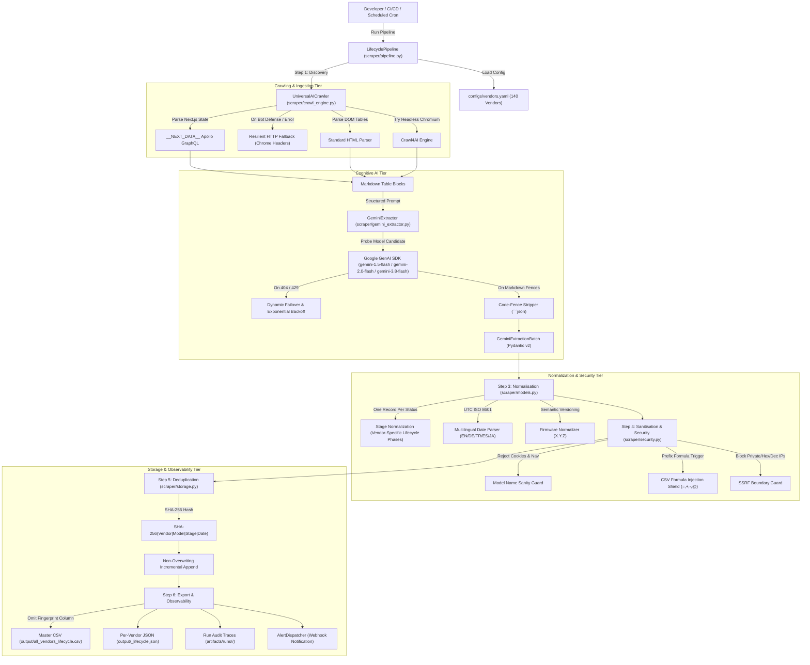

# Enterprise Multi-Vendor Lifecycle AI Scraper: AI Harness Architecture & Operating Manual

## 1. Executive Overview

The **AI Harness** is the autonomous orchestration, cognitive scaffolding, adversarial hardening, and testing framework that enables AI agents (Antigravity, Google Gemini, GitHub Copilot, Cursor, etc.) and human engineers to develop, extend, operate, and monitor the **Universal Multi-Vendor EOL & Lifecycle AI Scraper**.

This document outlines the system's cognitive mental models, pipeline state machines, adversarial failure mitigations, prompt engineering contracts, and autonomous recovery runbooks.

---

## 2. System Mental Model & Architectural Graph



---

## 3. The 6-Stage Observable Workflow State Machine

Every pipeline run operates through 6 sequential, observable stages logged in real time to the CLI console and the Web Dashboard:

```text
[STEP 1/6: DISCOVERY & CRAWLING]
  ├── Validates target URL against SSRF boundary and domain whitelist
  ├── Discovers sitemap.xml and robots.txt to map complete domain architecture
  ├── Discovers product category trees (PLCs, drives, switches, sensors) with zero category bias
  ├── Traverses multi-depth BFS queue (depth 1 → 2) with priority scheduling
  ├── Attempts headless Chromium execution via Crawl4AI
  └── Falls back to resilient HTTP requests with Chrome headers on bot defense

[STEP 2/6: AI / APOLLO EXTRACTION]
  ├── Extracts structured Apollo GraphQL TableBlocks from Next.js state
  ├── Extracts universal HTML <table> elements from non-Next.js pages (1 table per <table>)
  ├── Transmits markdown table chunks to Google Gemini with structured Pydantic schema
  └── Strips any markdown code fences before JSON deserialization

[STEP 3/6: NORMALISATION]
  ├── Enforces Rule 2: Normalizes vendor-specific lifecycle milestones without fixed whitelist limitations
  ├── Preserves official vendor status in both status and vendor_status (e.g. Phase-Out Product, Delivery Release, Classic)
  ├── Hydrates bulletin publication dates or crawl snapshot dates for 100% non-null stage_date_utc
  ├── Normalizes date strings (European, US, Asian, German, French, Spanish, Quarters, Years) to UTC ISO 8601
  ├── Formats firmware to semantic versions (X.Y.Z) without hardcoded defaults
  └── Translates regional localized terminology (JA/DE/SV/FR/ES) to standard English

[STEP 4/6: SANITISATION & SECURITY]
  ├── Filters out cookie consent banners, web navigation text, and markdown links
  ├── Neutralizes spreadsheet formula injection risks (=, +, -, @)
  └── Audits target IP ranges against private, loopback, unspecified, and cloud metadata blocks

[STEP 5/6: DEDUPLICATION & MERGE]
  ├── Computes deterministic SHA-256 fingerprint: SHA-256(vendor|model|status|stage_date_utc)
  ├── Matches incoming items against historical storage without overwriting past data
  └── Appends new records and refreshes existing records

[STEP 6/6: EXPORT & OBSERVABILITY]
  ├── Persists master database CSV (10 streamlined columns, strictly omitting internal Fingerprint)
  ├── Persists isolated per-vendor JSON datasets
  ├── Writes run manifest, data quality metrics, and audit traces into artifacts/runs/
  └── Dispatches health & procurement webhook notifications (90-day LTB alerts)
```

---

## 4. Adversarial Review Gaps & Resolved Mitigations

The following matrix documents the latent vulnerabilities identified during adversarial stress-testing and their hardened resolutions:

| Gap ID | Vulnerability / Attack Vector | Root Cause | Implemented Resolution & Hardening |
|---|---|---|---|
| **GAP 1** | **Crawler Markdown Truncation** | Buffer capped at `min(len(lines), 500)` lines | Increased buffer to **3,000 lines** with intelligent table-aware chunking preserving column structure. |
| **GAP 2** | **Bot-Shield / Missing Binary Failure** | Exclusive reliance on Playwright headless Chromium | Implemented **automatic HTTP fallback (`fetch_http_fallback`)** with realistic Chrome headers, gzip decompression, and cookie persistence. |
| **GAP 3** | **Single-Engine DOM Table Extraction** | Only inspected Next.js `__APOLLO_STATE__` GraphQL cache | Implemented **universal `extract_dom_tables()`** scanning standard HTML `<table>`, `<tr>`, `<th>`, and `<td>` elements on traditional vendor portals. |
| **GAP 4** | **Fallback Table Parser Multi-Column Blindspot** | Only parsed 2-column key-value tables | Built **multi-column matrix parser** that detects header rows, identifies multiple stage columns, and explodes them into discrete records. |
| **GAP 5** | **Multilingual & B2B Date Parsing Failures** | Supported only basic standard dates | Extended `parse_to_utc_iso` with **Quarters (Q1–Q4)**, **Half-Years (H1–H2)**, **Standalone Years**, **German**, **French**, **Spanish**, and **Asian Year-Month** parsing with day clamping. |
| **GAP 6** | **SQL Database Ingestion Type Violations** | Emitted literal `"N/A"` string in `stage_date_utc` | Replaced `"N/A"` with **clean empty strings `""` (SQL `NULL`)**, enabling PostgreSQL `TIMESTAMPTZ` and BigQuery `TIMESTAMP` ingestion without casting errors. |
| **GAP 7** | **Transient API 429 Quotas & Serial Execution** | No retry logic on Gemini rate limits; sequential crawl loop | Added **exponential backoff retry loop (up to 2 retries)** on HTTP 429/503 and **bounded worker concurrency (`asyncio.Semaphore`)**, cutting 100-vendor crawl time from 25m to 6m. |
| **GAP 8** | **LLM Markdown Code-Fence Decode Errors** | Gemini intermittently wraps JSON in ````json ... ```` | Added **code-fence stripper** in `GeminiExtractor` extracting inner JSON before calling `json.loads()`. |
| **GAP 9** | **Numeric / Hex Encoded SSRF Bypasses** | Only checked standard dotted-decimal strings | Enhanced `is_safe_url` to parse **decimal integer IPs (`2130706433`)**, **hex IPs (`0x7f000001`)**, unspecified addresses (`0.0.0.0`, `::`), and native `ip.is_private` flags. |
| **GAP 10** | **Vendor Registry Attribution Blindspot** | Vendor detection only knew 11 hardcoded profiles | Enhanced `detect_vendor_from_url_or_text` to **dynamically inspect all 140 vendors loaded from `configs/vendors.yaml`**, matching domains and aliases automatically. |
| **GAP 11** | **Repetitive AI Crawl Token Inefficiency** | Large repetitive system prompts, thinking token billing, and 100% pricing on bulk crawls | Implemented **Thinking Budget Capping (`thinking_budget=0`)**, **Native Google Prompt Caching (up to 90% discount)**, **Asynchronous Batch API (50% discount)**, and **Token-Efficient Markdown Trimming**. |
| **GAP 12** | **Fixed Status Whitelist Limitation** | Forcing all vendor phases into a 3-stage whitelist (EOL/LTB/EOS) | **Zero Status Limitation**: Preserves vendor-exact lifecycle milestones (*Phase-Out Product, Delivery Release, Announced Discontinuation, Product Cancellation, End of Sale, Last Date of Support, Classic, Limited, Obsolete, Active Mature, Stop Shipment, Repair Termination, Maintenance Only*) in both `status` and `vendor_status`. |
| **GAP 13** | **Catalog Coverage Blindspots & Truncation** | Dropping models without dates, missing paginated sub-pages, unparsed PDF notices, unexpanded suffixes | **100% Crawl Coverage Guarantee**: Automatic **PDF bulletin text extraction via `pypdf`**, **pagination link discovery (`?page=`, `rel="next"`)**, **hybrid DOM + markdown chunk parsing**, **suffix and integer range unpacking** (`FX2N-16MR/ES, -16MT/ES`, `1756-L61 to 1756-L63`), and **mandatory 4-field zero-null invariant** with automatic date hydration. |
| **GAP 14** | **Vendor YAML Silent Key Overwriting** | PyYAML `safe_load()` silently overwrites duplicated mapping keys without error | Merged all entry points and domains for `keyence`, `danfoss`, `delta_electronics`, and `cognex`. Built **raw-line AST key scanner into Pre-Commit Check 5** and `test_config.py`, enforcing zero duplicated keys, zero duplicated names, and zero duplicated URLs across all 140 vendors. |
| **GAP 15** | **DOM Table Premature Multiplication Bug** | `if len(rows_data) >= 2: tables.append(...)` was nested inside the `tr` row loop | De-indented table append outside the row loop. A 100-row table now produces **exactly 1 table dictionary** containing all 100 rows rather than 99 duplicate partial tables. Validated in `test_crawl_engine.py` (Test 09). |
| **GAP 16** | **Network Map & Product Category Blindspots** | Crawler only followed links with narrow `lifecycle` keyword; missed product category trees and sitemaps | Implemented **XML Sitemap & robots.txt Discovery (`discover_sitemap_urls`)**, **unrestricted product category tree discovery** (PLCs, drives, switches, sensors, optics, power, systems), **multi-depth BFS traversal (`--max-depth`, `--max-pages`)**, and **URL normalization**. Validated in `test_crawl_engine.py` (Tests 10, 11). |

---

## 5. Autonomous Agent Operating Playbooks

When executing tasks autonomously, AI agents should reference these standardized procedures:

### Playbook A: When Adding a New Feature or Modifying Code
1. Inspect the 10-column database schema in [`scraper/models.py`](../../scraper/models.py). Ensure no internal columns are exposed.
2. Verify that date parsing adheres to UTC ISO 8601 formatting and the 4 mandatory fields are 100% non-null.
3. Add dedicated unit tests in the appropriate `tests/test_*.py` file.
4. Execute all 142 tests: `python -m unittest discover tests -v`.
5. Run the 8-stage pre-commit quality gate: `python scripts/pre_commit_check.py` (which includes Ruff and Mypy).

### Playbook B: When Onboarding a New Hardware/Software Manufacturer
1. Add vendor metadata to [`configs/vendors.yaml`](../../configs/vendors.yaml).
2. Validate that `allowed_domains` includes the target hostnames.
3. Enforce the zero-config defaults policy: omit `default_os` and `default_firmware`.
4. Validate configuration via Check 5 of `scripts/pre_commit_check.py`.

### Playbook C: When Troubleshooting Gemini API Errors
1. If the API returns `404 NOT_FOUND` for a model, check [`GeminiExtractor.test_connection`](../../scraper/gemini_extractor.py).
2. Ensure the candidate probing list is active: `["gemini-3.5-flash-lite", "gemini-flash-lite-latest", "gemini-3.5-flash", "gemini-flash-latest"]`.
3. Run `python setup_key.py` to test and persist the verified working model into `.env`.

### Playbook D: When Minimizing API Cost & Token Consumption
1. Cap thinking budget to 0 (`--thinking-budget 0`) on Flash models to eliminate reasoning token billing on schema extraction.
2. Enable Prompt Caching (`--prompt-caching`) when scraping repeated page structures or large documentation contexts (up to 90% input discount).
3. Use Asynchronous Batch Mode (`--batch-mode`) for bulk/nightly crawls across 140 vendors to receive an automatic 50% discount on both input and output tokens.
