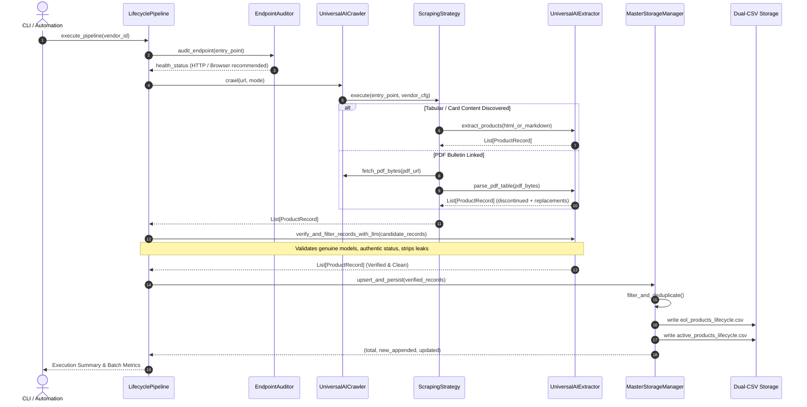
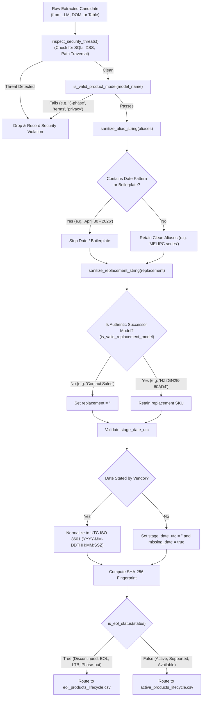
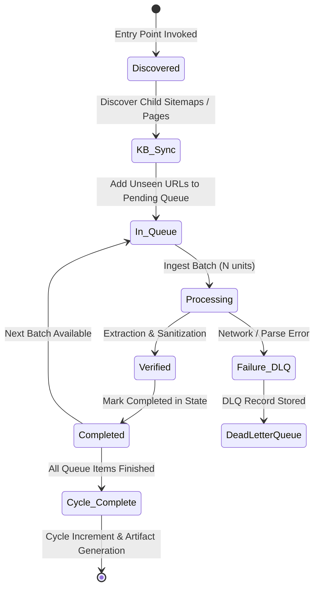

# Operational Workflows & Execution Flows

## 1. End-to-End Crawl & Ingestion Sequence

---

## 2. Product Record Sanitization & Validation Flow

---

## 3. Knowledge Base Synchronization & Batch Queueing Flow

