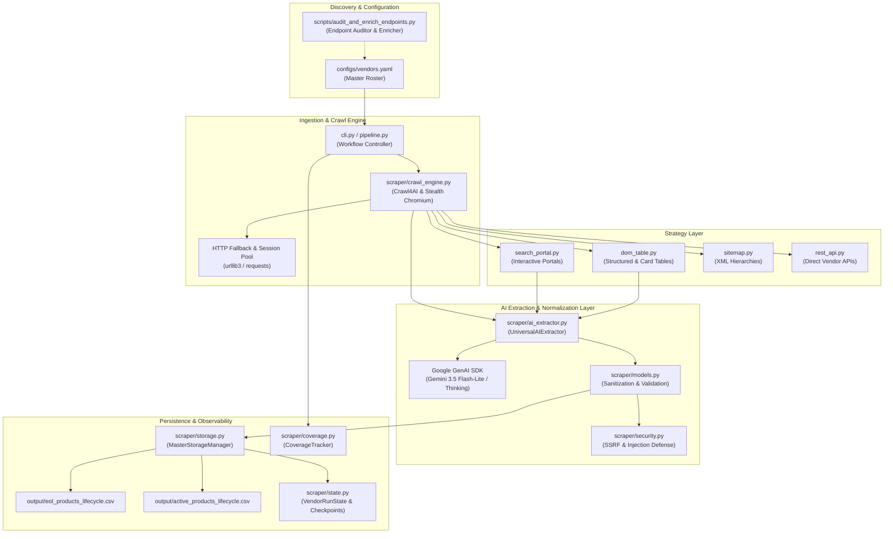

# Technical Architecture & Design Specification

## 1. System Decomposition

The Universal Lifecycle Scraper is engineered as an asynchronous, multi-tiered intelligence pipeline designed to ingest, normalize, and persist hardware and software lifecycle data across enterprise industrial vendors.

---

## 2. Ingestion & Crawl Engine (`scraper/crawl_engine.py`)

1. **Anti-Bot & WAF Handling**:
   - Protected vendor catalogs (e.g., Schneider Electric, Cisco, Rockwell on Akamai/Cloudflare) block standard HTTP client requests with HTTP 403 Forbidden.
   - The crawl engine leverages Crawl4AI's asynchronous headless Playwright/Chromium engine (`crawler_mode: browser`) configured with user-agent rotation, stealth navigator shims, and realistic viewport sizes.
2. **Deterministic HTTP Fast-Path**:
   - For open, static documentation portals, the engine operates in high-throughput HTTP mode (`crawler_mode: http`), falling back to browser automation only upon encountering WAF challenges or JavaScript-dependent markup.
3. **Session Re-use & Rate Limiting**:
   - Connection pools are isolated per domain with bounded concurrency to respect vendor robots policies and prevent aggressive request throttling.

---

## 3. Strategy Layer (`scraper/strategies/`)

The pipeline decouples vendor parsing into four pluggable strategy classes extending `BaseScrapingStrategy`:

1. **`DomTableStrategy` (`dom_table.py`)**:
   - **Pattern A (Multi-Row Discontinuation Tables)**: Extracts tabular records with multiple model columns, series headers, and discrete lifecycle milestones.
   - **Pattern B (Card-Based Tables)**: Parses vertical card chunks without truncation, mapping card titles to product family aliases.
   - **Pattern C (PDF Linked Tables)**: Detects links to official EOL PDF bulletins, downloads linked documents, parses embedded tabular matrices via `pypdf`, and extracts direct replacement SKUs.
2. **`SearchPortalStrategy` (`search_portal.py`)**:
   - Automates interaction with dynamic search interfaces, issuing query keywords, paginating through result sets, and harvesting lifecycle states.
3. **`SitemapStrategy` (`sitemap.py`)**:
   - Recursively resolves XML sitemap indices without artificial depth limits.
   - Enforces the Zero-Inference Doctrine: `<lastmod>` timestamps are strictly disregarded as lifecycle dates, and non-product URL slugs are filtered out prior to record emission.
4. **`RestApiStrategy` (`rest_api.py`)**:
   - Queries documented and semi-structured vendor REST endpoints with token authentication, extracting direct JSON payload models.

---

## 4. Universal AI Extraction Layer (`scraper/ai_extractor.py`)

1. **Model Architecture**:
   - Primary: `gemini-3.5-flash-lite` via the Google GenAI SDK.
   - Pluggable Support: OpenAI (`gpt-4o-mini`), Anthropic Claude (`claude-3-5-haiku`), Azure OpenAI, AWS Bedrock, and local Ollama instances.
2. **System Instruction Governance**:
   - Incorporates the Constitutional Zero-Inference Rules directly into the system prompt.
   - Requires Pydantic-enforced structured JSON output (`AIExtractionBatch`) ensuring schema conformity before records touch memory.
3. **Token & Latency Optimizations**:
   - Prompt Caching: Re-uses system instructions across continuous chunk sequences.
   - Thinking Budget: Allocated where complex multi-language disambiguation (e.g. Japanese, German lifecycle terms) is required.
4. **Pre-Persistence Verification Gate (`verify_and_filter_records_with_llm`)**:
   - All candidate records harvested from DOM tables, sitemaps, or portal crawlers pass through a dedicated LLM verification gate prior to database/CSV persistence.
   - Role of LLM: Strict verification and correct parsing only. The LLM verifies each candidate:
     - Confirms that `model_name` represents an authentic industrial hardware or software product, rejecting website chrome, URL slugs (`terms`, `text-display`, `timing-relays`, `tools`, `top-connect`), and manuals.
     - Confirms that `status` is explicitly disclosed by the manufacturer without inference.
     - Confirms that `stage_date_utc` is the exact milestone date for that product, preventing date leakage into `aliases` or `replacement`.
     - Validates and sanitizes multi-model unbundling and family prefix inheritance.

---

## 5. Data Sanitization & Model Validation (`scraper/models.py`)

1. **`is_valid_product_model(name)`**:
   - Rejects UI navigation tokens, cookie consent text, row index numbers, and generic categories.
   - Rejects electrical engineering ratings (`3-phase`, `1-phase`, `24VDC`, `10A`).
   - Rejects documentation artifacts (`replacement manual`, `includes the following models:`).
   - Rejects pure calendar dates or strings containing calendar dates.
2. **`sanitize_alias_string(val)`**:
   - Preserves legitimate family names (e.g., `MELIPC series`, `An Series`).
   - Strips lead-in boilerplate (`example of main units`, `includes following models:`).
   - Eliminates calendar dates with 100% precision.
3. **`sanitize_replacement_string(val)`**:
   - Validates that replacement entries are authentic successor hardware/software part numbers.
   - Purges placeholder boilerplate (`Contact Sales`, `Refer to Bulletin`, `Not Applicable`).

---

## 6. Storage & State Persistence (`scraper/storage.py`)

1. **Dual-CSV Partitioning**:
   - `eol_products_lifecycle.csv`: Products in `{"Phase Out", "End of Sale", "End of Support", "Obsolete"}`.
   - `active_products_lifecycle.csv`: Products in `{"Active", "Active Mature"}`.
2. **SQLite Incremental Staging Buffer (`output/staging_buffer.db`)**:
   - Solves the disk I/O bottleneck in `--all-vendors` runs across 219 vendors.
   - Crawlers write updates incrementally into an append-only SQLite database using `INSERT ... ON CONFLICT DO UPDATE`.
   - Dual master CSVs are exported in a single consolidated batch upon completion via `flush_consolidated_csvs()`.
3. **Deterministic Fingerprinting & Latest-Date Deduplication**:
   - Each record receives a canonical SHA-256 fingerprint:
     $$\text{Fingerprint} = \text{SHA256}(\text{VENDOR} \parallel \text{MODEL} \parallel \text{CANONICAL\_STATUS})[:16]$$
   - Guarantees strictly ONE record per `(vendor, model, canonical_status)` milestone.
   - When milestone collisions occur, `compare_and_select_latest_record` preserves the record with the most recent `stage_date_utc` and losslessly merges non-empty attributes.
4. **Atomic Safe File Writes**:
   - CSV and JSON files are written to `.tmp` files and committed via atomic replacement (`safe_atomic_replace`), eliminating partial or corrupt writes.

